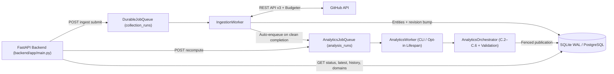

# OpenSourceLens

**Deep, evidence-backed intelligence for any public GitHub repository.**

Submit a public GitHub URL or `owner/repo` slug, and OpenSourceLens collects rich underlying engineering and community data exposed by GitHub's public APIs—commits, contributors, issues, comments, pull requests, code reviews, releases, and (planned) discussions—and analyzes it using **statistical Data Science, Machine Learning, and Deep Learning**.

Instead of repeating surface-level GitHub counters (stars, forks, raw totals), OpenSourceLens helps **contributors**, **maintainers**, and **anyone evaluating a repository** understand how a project actually behaves beneath the surface.

> **Start here:** Read [docs/product-vision.md](./docs/product-vision.md) for the complete, jargon-free explanation of what OpenSourceLens covers, what is out of scope, what already runs today, and the stepwise execution roadmap.

---

## What OpenSourceLens Helps You Understand

- **If you want to contribute:** *How quickly do human maintainers actually respond to pull requests? Which issues stay open for months versus closing within days? Have other contributors already filed duplicate or closely related issues?*
- **If you maintain a repository:** *Is development momentum speeding up or slowing down? Does the project depend too heavily on one or two contributors (`BF50` / Gini concentration)? Which topics keep recurring across open issues?*
- **If you are evaluating a project:** *Are releases predictable (`CV_release`, SemVer compliance) or sporadic? Do spikes in churn or commit velocity align with incoming bug reports or PR review delays?*

---

## Scope Boundaries (In Scope vs. Out of Scope)

| In Scope | Explicitly Out of Scope |
|---|---|
| Any eligible **public** GitHub repository (`owner/repo` or URL) | Static source-code inspection, AST parsing, or code-complexity auditing |
| Rich public **GitHub API** telemetry: issues, comments, labels, assignees, reactions, PRs, PR reviews, inline review comments, branches/diffs, commits, contributors, releases, and **GitHub Discussions** (planned) | GitHub Actions / CI-CD workflow log analytics |
| Statistical analytics, survival curves, inequality/bus factor, generalizable issue/PR classification, per-repo duplicate similarity, and topic discovery | Dependency graph / SBOM / security vulnerability scanning |
| Interactive analytical dashboards, visual charts, and consolidated reports | Conversational AI / RAG chatbot interfaces |

The four repositories bundled in `data/` (`microsoft/vscode`, `pytorch/pytorch`, `kubernetes/kubernetes`, `huggingface/transformers`) are strictly **offline benchmark datasets** used for research and model validation—never product boundaries.

---

## Core Intelligence Areas & How DS / ML / DL Fit In

OpenSourceLens separates **objective statistical measurement** from **applied Machine Learning / Deep Learning** so insights stay honest, reproducible, and free of inflated scores:

1. **Repository Context & Community Profile** *(Planned Expansion)* — Public repo metadata, tags fallback, and **GitHub Discussions** (volume, categories, answered Q&A rates, recurring community topics).
2. **Development Activity & Commit History** — Rolling 4w/12w/52w commit velocities, completed-week consistency & CV, rolling anomalies (robust MAD / z-score / Poisson), `max_ssb` permutation change-points, `7x24` UTC rhythms, diff-aware code churn, and commit landing latency.
3. **Contributors & Collaboration Ecosystem** — Identity-clean contributor mapping (`github_id` + unlinked email fallback, bots separated), multi-role counts (commits, PRs, reviews, issues, comments), Gini inequality, 11-point Lorenz deciles, Shannon entropy, bus factors (`BF50` / `BF80`), and history-gated cohort retention.
4. **Pull Request & Code-Review Lifecycle** — Separated response metrics (`TTFResp`, formal `TTFR_formal`, inline `TTFR_inline`), merge vs. abandonment rates, merge latency quantiles, Kaplan-Meier PR survival, diff-size turnaround buckets, reviewer load concentration, plus planned PR descriptions/branches/draft/diff depth.
5. **Issue & Backlog Intelligence** — Monthly inflow/outflow, pure issue backlog separation, timestamp-derived SLA percentiles, right-censored Kaplan-Meier survival (`S(30d)`/`S(60d)`/`S(90d)`), 5-bin backlog aging, discussion intensity, canonical categorization (NLP), plus planned per-repo semantic duplicate retrieval and unsupervised topic discovery.
6. **Release & Project Evolution** — Inter-release cadence predictability (`CV_release`), SemVer 2.0.0 adoption, pre-release commit surges (`14d` vs. prior `60d`), and release dormancy (+ planned tags/release notes).
7. **Cross-Domain Discovery & Consolidated Report** — Multi-domain diagnostic scorecard, deterministic consolidated findings, and monthly cross-domain Spearman permutation tests (`B = 10,000`, `|r_AR1| > 0.40` autocorrelation guard, Benjamini-Hochberg FDR `alpha = 0.05`).

---

## Honest Project State: Implemented Foundation & Cleanup Status

- **Implemented Backend Subsystems (`backend/`):**
  - **Phase B Dynamic Ingestion:** GitHub URL validation, public/non-empty eligibility gating, request budget modes (`fast_snapshot` 10 reqs / `standard_diagnostic` 50 reqs), RFC 5988 pagination, lease-fenced `DurableJobQueue`, `IngestionWorker`, and automatic post-ingestion analytics enqueueing.
  - **Phase C Analytics Engine (`methodology_version = "2026.1"`):** Six-domain statistical calculators (`DevelopmentActivity`, `ContributorIntelligence`, `PullRequestIntelligence`, `IssueIntelligence`, `ReleaseEvolution`, `CrossDomainSynthesis`), snapshot-isolated `AnalyticsOrchestrator`, `AnalyticsWorker`, and Analytics V2 endpoints (`/api/v1/analytics/{owner}/{name}/...`).
  - **Production NLP Utilities (`backend/app/services/nlp/`):** Clean text cleaning (`IssueTextCleaner`), dense vector embeddings (`IssueEmbedder`), and classification pipelines (`classifiers.py`).
- **Stage 1 Strict Cleanup (Completed):**
  - Removed obsolete Streamlit prototype (`demo_app.py`), duplicate legacy collectors (`ml/data_collection/`), ad-hoc scripts (`scripts/`), deleted Phase A endpoints (`/repos`, `/related`, `/resolution`), and dead schemas.
  - Removed legacy offline lab scripts (`ml/`), benchmark-dummy RF velocity models, and hardcoded Phase 10 frontend registries (`REPO_REGISTRY`, `FALLBACK_ISSUE_CORPUS`).
- **Next Roadmap Stages:**
  - **Stage 2:** Backend stabilization, Alembic Migration 001 fresh-DB schema drift fix, and live unseen-repository E2E verification.
  - **Stage 3:** Richer GitHub entity depth (PR diff stats, branches, bodies, assignees, reactions) and GitHub Discussions integration.
  - **Stage 4:** Interactive Next.js single-repository intelligence workspace UI.
  - **Stage 5:** Generalizable 5-class NLP categorization and per-repository dynamic semantic duplicate retrieval.
  - **Stage 6:** Cross-domain discovery explorer, downloadable reports, and Dockerized production deployment.

---

## End-to-End Architecture



---

## Repository Layout

```text
OpenSourceLens/
├── alembic.ini                 # Alembic config (invoke via `python -m alembic`)
├── docker-compose.yml          # PostgreSQL 16-alpine DB container config
├── requirements.txt            # Root Python HTTP/tabular dependencies
├── backend/
│   ├── requirements.txt        # FastAPI, SQLAlchemy, Alembic, Pydantic
│   ├── alembic/                # Migrations 001, 002, 003
│   └── app/
│       ├── main.py             # FastAPI factory, lifespan, /, /health
│       ├── api/v1/             # API routers (ingest, Analytics V2, classify, models)
│       ├── core/               # Settings, exceptions, uniform error envelopes
│       ├── database/           # SQLAlchemy 2.0 ORM (17 tables), session, init_db
│       ├── schemas/            # Pydantic v2 contracts (analytics_v2, ingestion, etc.)
│       └── services/           # Collector, client, budgeter, queues, workers, analytics/, nlp/
├── docs/                       # Product vision, technical specs, roadmap
├── frontend/                   # Next.js 15.5 + React 19 UI shell
├── models/                     # Production model artifacts (DistilBERT fine-tuned, classical baselines)
├── data/
│   ├── opensource_lens.db      # Offline 4-repo SQLite benchmark DB (2,328 issues)
│   └── raw/, processed/        # Offline training and benchmark corpus
└── tests/                      # Active pytest unit and integration test suite (382 tests)
```

---

## Local Setup & Running Backend Services

### 1. Python Environment
```powershell
python -m venv .venv
.\.venv\Scripts\Activate.ps1
pip install -r requirements.txt
pip install -r backend\requirements.txt
```
Analytics statistics and ML endpoints rely on packages installed in the project virtualenv (`numpy`, `scipy`, `torch`, `transformers`, `sentence-transformers`, `scikit-learn`, `pytest`, `httpx`).

### 2. Environment Variables
Copy `.env.example` to `.env` (never commit `.env` or secrets):
- `DATABASE_URL`: SQLAlchemy URL (defaults to local SQLite `data/opensource_lens.db`).
- `GITHUB_TOKEN`: GitHub Personal Access Token (raises public REST rate limit from `60 req/hr` to `5,000 req/hr`).
- `BACKEND_CORS_ORIGINS`: Allowed frontend origins (default `["http://localhost:3000", "http://127.0.0.1:3000"]`).
- `PREWARM_ON_STARTUP`: Preload ML models on startup (`false` default).
- Worker controls: `ENABLE_ANALYTICS_WORKER` (`false`), `ANALYTICS_WORKER_POLL_INTERVAL_SECONDS` (`1.0`), `ANALYTICS_WORKER_RECONCILE_INTERVAL_SECONDS` (`60.0`).

### 3. Migrations & Services
```powershell
# Inspect current migration state
.\.venv\Scripts\python.exe -m alembic -c alembic.ini current

# Start FastAPI server (Swagger UI at http://127.0.0.1:8000/docs)
.\.venv\Scripts\python.exe -m uvicorn backend.app.main:app --host 127.0.0.1 --port 8000 --reload

# Start AnalyticsWorker (standalone process)
.\.venv\Scripts\python.exe -m backend.app.services.analytics_worker

# Start IngestionWorker
.\.venv\Scripts\python.exe -c "import asyncio; from backend.app.database.session import SessionLocal; from backend.app.services.ingestion_worker import IngestionWorker; asyncio.run(IngestionWorker().run_worker_loop(SessionLocal))"
```

### 4. Running Tests
```powershell
# Run the complete test suite
.\.venv\Scripts\python.exe -m pytest tests/ -q
```
