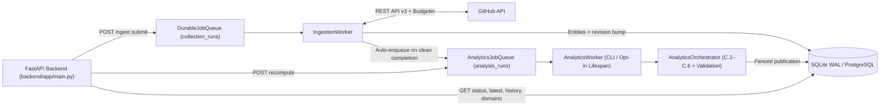

# OpenSourceLens

**Deep, evidence-backed intelligence for any public GitHub repository.**

Submit a public GitHub URL or `owner/repo` slug, and OpenSourceLens collects rich underlying engineering and community data exposed by GitHub's public APIs—commits, contributors, issues, comments, pull requests, code reviews, releases, and (planned) discussions—and analyzes it using **statistical Data Science, Machine Learning, and Deep Learning**.

Instead of repeating surface-level GitHub counters (stars, forks, raw totals), OpenSourceLens helps **contributors**, **maintainers**, and **anyone evaluating a repository** understand how a project actually behaves beneath the surface.

> **Start here:** Read [docs/product-vision.md](./docs/product-vision.md) for the complete, jargon-free explanation of what OpenSourceLens covers, what is out of scope, what already runs today, and what legacy prototype files are slated for removal.

---

## What OpenSourceLens Helps You Understand

- **If you want to contribute:** *How quickly do human maintainers actually respond to pull requests? Which issues stay open for months versus closing within days? Have other contributors already filed duplicate or closely related issues?*
- **If you maintain a repository:** *Is development momentum speeding up or slowing down? Does the project depend too heavily on one or two contributors (`BF50` / Gini concentration)? Which topics keep recurring across open issues?*
- **If you are evaluating a project:** *Are releases predictable (`CV_release`, SemVer compliance) or sporadic? Do spikes in churn or commit velocity align with incoming bug reports or PR review delays?*

---

## Scope Boundaries (In Scope vs. Out of Scope)

| In Scope | Explicitly Out of Scope |
|---|---|
| Any eligible **public** GitHub repository (`owner/repo` or URL) | Static source-code inspection, AST parsing, or code-complexity auditing |
| Rich public **GitHub API** telemetry: issues, comments, labels, assignees, reactions, PRs, PR reviews, inline review comments, branches/diffs, commits, contributors, releases, and **GitHub Discussions** (planned) | GitHub Actions / CI-CD workflow log analytics |
| Statistical analytics, survival curves, inequality/bus factor, generalizable issue/PR classification, per-repo duplicate similarity, and topic discovery | Dependency graph / SBOM / security vulnerability scanning |
| Interactive analytical dashboards, visual charts, and consolidated reports | Conversational AI / RAG chatbot interfaces |

The four repositories bundled in `data/` (`microsoft/vscode`, `pytorch/pytorch`, `kubernetes/kubernetes`, `huggingface/transformers`) are strictly **offline benchmark datasets** used for research and model validation—never product boundaries.

---

## Core Intelligence Areas & How DS / ML / DL Fit In

OpenSourceLens separates **objective statistical measurement** from **applied Machine Learning / Deep Learning** so insights stay honest, reproducible, and free of inflated scores:

1. **Repository Context & Community Profile** *(Planned Expansion)* — Public repo metadata, tags fallback, and **GitHub Discussions** (volume, categories, answered Q&A rates, recurring community topics).
2. **Development Activity & Commit History** — Rolling 4w/12w/52w commit velocities, completed-week consistency & CV, rolling anomalies (robust MAD / z-score / Poisson), `max_ssb` permutation change-points, `7x24` UTC rhythms, diff-aware code churn, and commit landing latency.
3. **Contributors & Collaboration Ecosystem** — Identity-clean contributor mapping (`github_id` + unlinked email fallback, bots separated), multi-role counts (commits, PRs, reviews, issues, comments), Gini inequality, 11-point Lorenz deciles, Shannon entropy, bus factors (`BF50` / `BF80`), and history-gated cohort retention.
4. **Pull Request & Code-Review Lifecycle** — Separated response metrics (`TTFResp`, formal `TTFR_formal`, inline `TTFR_inline`), merge vs. abandonment rates, merge latency quantiles, Kaplan-Meier PR survival, diff-size turnaround buckets, reviewer load concentration, plus planned PR descriptions/branches/draft/diff depth.
5. **Issue & Backlog Intelligence** — Monthly inflow/outflow, pure issue backlog separation, timestamp-derived SLA percentiles, right-censored Kaplan-Meier survival (`S(30d)`/`S(60d)`/`S(90d)`), 5-bin backlog aging, discussion intensity, canonical categorization (NLP), plus planned per-repo semantic duplicate retrieval and unsupervised topic discovery.
6. **Release & Project Evolution** — Inter-release cadence predictability (`CV_release`), SemVer 2.0.0 adoption, pre-release commit surges (`14d` vs. prior `60d`), and release dormancy (+ planned tags/release notes).
7. **Cross-Domain Discovery & Consolidated Report** — Multi-domain diagnostic scorecard, deterministic consolidated findings, and monthly cross-domain Spearman permutation tests (`B = 10,000`, `|r_AR1| > 0.40` autocorrelation guard, Benjamini-Hochberg FDR `alpha = 0.05`).

> **Why no composite "health score" or exact countdown timer?** OpenSourceLens intentionally avoids arbitrary `0–100` grades and exact issue-hour countdown predictions (offline Phase 8 evaluation showed within-repo $R^2$ ranges from `-0.04` to `+0.18` because maintainer availability happens after creation). Missing or partial streams are flagged explicitly instead of coerced to `0`.

---

## Honest Project State: Implemented vs. Next vs. Slated for Cleanup

- **Implemented Backend (`backend/`):**
  - **Phase B Dynamic Ingestion:** GitHub URL validation, public/non-empty eligibility gating, request budget modes (`fast_snapshot` 10 reqs / `standard_diagnostic` 50 reqs), RFC 5988 pagination, lease-fenced `DurableJobQueue`, `IngestionWorker`, and automatic post-ingestion analytics enqueueing.
  - **Phase C Analytics Engine (`methodology_version = "2026.1"`):** Six-domain statistical calculators (`DevelopmentActivity`, `ContributorIntelligence`, `PullRequestIntelligence`, `IssueIntelligence`, `ReleaseEvolution`, `CrossDomainSynthesis`), snapshot-isolated `AnalyticsOrchestrator`, `AnalyticsWorker`, and Analytics V2 endpoints (`/api/v1/analytics/{owner}/{name}/...`).
- **Pending Product Gaps:**
  - Harvesting **GitHub Discussions**, PR diff stats/branches/bodies/requested reviewers from `/pulls` details, deeper commit diffs, issue reactions/assignees, and repo tags fallback.
  - Decoupling ML/NLP from benchmark artifacts (`embeddings.npz` static lookup and 4-repo dummy encodings in `ResolutionPredictor`) so semantic duplicate search, 5-class categorization, and topic discovery run dynamically per ingested repository.
  - Wiring the Next.js frontend ([`frontend/`](./frontend/)) to the dynamic ingestion + Analytics V2 endpoints.
  - Operational fixes tracked in [the backend audit](./docs/audits/OPENSOURCELENS_BACKEND_AUDIT.md) (Migration `001` fresh-DB drift, `IngestionWorker` CLI entrypoint, `rate_limited` auto-resumption, live PostgreSQL multi-worker verification).
- **Legacy Prototype Components Slated for Later Code Removal:**
  - `demo_app.py` (old Streamlit prototype), legacy `scripts/verify_*.py` scripts, `backend/app/database/{ingest.py,schema.sql,schema_generator.py}`, legacy Phase A `/api/v1/repos*` & legacy `/api/v1/analytics/*` snapshots, static `embeddings.npz` coupling, benchmark-dummy RF velocity encodings, and Phase 10 hardcoded UI fallbacks (`REPO_REGISTRY`, `FALLBACK_ISSUE_CORPUS`). *(These remain untouched in code until the dedicated code-cleanup step.)*

---

## End-to-End Architecture



---

## Documentation Guide

| Document | Audience & Purpose |
|---|---|
| [docs/product-vision.md](./docs/product-vision.md) | Clear product vision, scope boundaries, 7 analytical areas, DS/ML fit, and legacy cleanup register |
| [docs/architecture.md](./docs/architecture.md) | System architecture, component flow, queues, orchestrator, and legacy ML services |
| [docs/ingestion.md](./docs/ingestion.md) | 12-stage GitHub collection lifecycle, request budgets, rate-limit handling, and depth gaps |
| [docs/analytics.md](./docs/analytics.md) | Mathematical formulas, statistical guards, sample gates, and rule IDs across all 6 backend domains |
| [docs/database.md](./docs/database.md) | SQLAlchemy 2.0 ORM tables, source revisions, lease fencing, and Migration `001` warning |
| [docs/api.md](./docs/api.md) | Complete HTTP contract for ingestion, Analytics V2, and legacy Phase A endpoints |
| [docs/workers-and-deployment.md](./docs/workers-and-deployment.md) | Environment variables, worker execution, lease recovery, and SQLite vs. PostgreSQL notes |
| [docs/audits/OPENSOURCELENS_BACKEND_AUDIT.md](./docs/audits/OPENSOURCELENS_BACKEND_AUDIT.md) | Detailed technical audit of the backend, gaps, and verification priorities |
| [docs/roadmap.md](./docs/roadmap.md) | Milestone history (pending separate update after doc alignment) |

---

## Repository Layout

```text
OpenSourceLens/
├── alembic.ini                 # Alembic config (invoke via `python -m alembic`)
├── docker-compose.yml          # PostgreSQL 16-alpine DB container config
├── requirements.txt            # Root Python HTTP/tabular dependencies
├── demo_app.py                 # Legacy Streamlit prototype (scheduled for removal)
├── backend/
│   ├── requirements.txt        # FastAPI, SQLAlchemy, Alembic, Pydantic
│   ├── alembic/                # Migrations 001, 002, 003
│   └── app/
│       ├── main.py             # FastAPI factory, lifespan, /, /health
│       ├── api/v1/             # API routers (ingest, Analytics V2, legacy Phase A)
│       ├── core/               # Settings, exceptions, uniform error envelopes
│       ├── database/           # SQLAlchemy 2.0 ORM (17 tables), session, init_db
│       ├── schemas/            # Pydantic v2 contracts
│       └── services/           # Collector, GitHub client, budgeter, queues, workers, analytics/
├── docs/                       # Product vision & technical specifications
├── frontend/                   # Next.js 15 Phase 10 UI prototype (not yet wired to V2 API)
├── ml/                         # Offline benchmark research, EDA, NLP, DistilBERT & RF scripts
├── models/                     # Offline benchmark artifacts (DistilBERT, static embeddings.npz, RF)
├── data/
│   ├── opensource_lens.db      # Offline 4-repo SQLite benchmark DB (2,328 issues; 0 Phase B/C runs)
│   └── raw/, processed/
├── scripts/                    # Legacy verification scripts (scheduled for cleanup)
└── tests/                      # 1,079 collected pytest unit and integration tests
```

---

## Local Setup & Running Backend Services

### 1. Python Environment
```powershell
python -m venv .venv
.\.venv\Scripts\Activate.ps1
pip install -r requirements.txt
pip install -r backend\requirements.txt
```
Analytics statistics and ML endpoints also rely on packages installed in the project virtualenv (`numpy`, `scipy`, `torch`, `transformers`, `sentence-transformers`, `scikit-learn`, `pytest`, `httpx`).

### 2. Environment Variables
Copy `.env.example` to `.env` (never commit `.env` or secrets):
- `DATABASE_URL`: SQLAlchemy URL (defaults to local SQLite `data/opensource_lens.db`).
- `GITHUB_TOKEN`: GitHub Personal Access Token (raises public REST rate limit from `60 req/hr` to `5,000 req/hr`).
- `BACKEND_CORS_ORIGINS`: Allowed frontend origins (default `["http://localhost:3000", "http://127.0.0.1:3000"]`).
- `PREWARM_ON_STARTUP`: Preload Phase A ML models on startup (`false` default).
- Worker controls read by `backend/app/core/config.py`: `ENABLE_ANALYTICS_WORKER` (`false`), `ANALYTICS_WORKER_POLL_INTERVAL_SECONDS` (`1.0`), `ANALYTICS_WORKER_RECONCILE_INTERVAL_SECONDS` (`60.0`). See [docs/workers-and-deployment.md](./docs/workers-and-deployment.md).

### 3. Migrations & Services
```powershell
# Inspect current migration state
.\.venv\Scripts\python.exe -m alembic -c alembic.ini current

# Start FastAPI server (Swagger UI at http://127.0.0.1:8000/docs)
.\.venv\Scripts\python.exe -m uvicorn backend.app.main:app --host 127.0.0.1 --port 8000 --reload

# Start AnalyticsWorker (standalone process)
.\.venv\Scripts\python.exe -m backend.app.services.analytics_worker

# Start IngestionWorker (no __main__ CLI yet)
.\.venv\Scripts\python.exe -c "import asyncio; from backend.app.database.session import SessionLocal; from backend.app.services.ingestion_worker import IngestionWorker; asyncio.run(IngestionWorker().run_worker_loop(SessionLocal))"
```
*(Note: Provisioning a brand-new empty DB via `alembic upgrade head` currently hits Phase A column drift in Migration `001` documented in [docs/database.md](./docs/database.md#4-alembic-migrations--known-schema-drift-warning).)*

### 4. Tests
```powershell
# Discover full suite (1,079 tests collected)
.\.venv\Scripts\python.exe -m pytest --collect-only -q

# Run backend ingestion, analytics engine, worker, and API suites (live GitHub tests opt-in via RUN_LIVE_GITHUB_TESTS=1)
.\.venv\Scripts\python.exe -m pytest tests/test_alembic_migrations.py tests/test_github_url_validator.py tests/test_repository_eligibility.py tests/test_github_client.py tests/test_rate_budgeter.py tests/test_async_repository_collector.py tests/test_collector_mutation_tracking.py tests/test_durable_job_queue.py tests/test_e2e_ingestion_lifecycle.py tests/test_api_ingest.py tests/test_analytics_foundation.py tests/test_analytics_queue.py tests/test_development_activity.py tests/test_contributor_intelligence.py tests/test_pull_request_intelligence.py tests/test_issue_intelligence.py tests/test_release_and_cross_domain_intelligence.py tests/test_analytics_orchestrator.py tests/test_analytics_worker.py tests/test_post_ingestion_analytics_wiring.py tests/test_api_analytics_v2.py tests/test_api_analytics.py tests/test_api_app.py tests/test_api_error_handling.py tests/test_api_repos.py tests/test_api_models.py tests/test_api_classification.py tests/test_api_related.py tests/test_api_resolution.py -q
```
