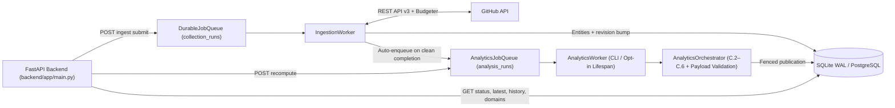

# OpenSourceLens — Data Science-Powered GitHub Repository Intelligence Platform

**OpenSourceLens** is a Data Science and backend engineering platform that collects publicly available telemetry from **any eligible public GitHub repository** (`owner/repo` or GitHub URL) and computes multi-domain statistical analytics, machine learning diagnostics, and evidence-backed findings beyond raw GitHub vanity counts.

---

## 1. Problem Statement & Intended Audience

Raw GitHub repository pages surface surface-level counters (stars, open issues, total commits), which do not answer operational engineering questions:
- Is development velocity accelerating, steady, volatile, or undergoing a structural change-point?
- Is commit participation concentrated in a fragile bus factor (`BF50`/`BF80`, Gini inequality)?
- How fast do external human reviewers respond to pull requests (`TTFResp` vs. `TTFR_formal`), and where are merge bottlenecks?
- What is the age profile and survival curve of the open issue backlog, separate from PRs?
- Do changes in churn, review responsiveness, or commit pace empirically covary across months?

**Intended Audience:** Open-source maintainers evaluating triage and review health, contributors assessing project responsiveness before investing effort, engineering leads conducting dependency risk due diligence, and software engineering researchers studying empirical repository dynamics.

---

## 2. Key Capabilities

- **Dynamic GitHub Ingestion Engine (Phase B):** Strict URL validation, pre-flight repository eligibility checks (public accessibility, non-empty code gate, fork/archived awareness), tiered API request budgeting (`fast_snapshot`: 10 requests, `standard_diagnostic`: 50 requests), RFC 5988 pagination, rate-limit backoff/halting, and atomic source revision tracking.
- **Durable Job Queues & Workers:** SQL-backed `DurableJobQueue` (`collection_runs`) and `AnalyticsJobQueue` (`analysis_runs` / `analysis_run_attempts`) with monotonic `lease_version` fencing, stale-run protection, and automatic post-ingestion analytics enqueueing.
- **Six-Domain Analytics Engine (`methodology_version = "2026.1"`, Phase C.1–C.7):**
  1. **Development Activity:** Rolling 4w/12w/52w velocities, completed-week consistency & CV, 4w/12w rolling SMA & EWMA, adaptive robust-MAD/z-score/Poisson anomaly detection, `max_ssb` permutation change-points, 7x24 UTC rhythms, diff-aware code churn, and commit landing latency.
  2. **Contributor Ecosystem:** Immutable `github_id` actor hygiene, bot/unattributed isolation, Gini coefficient, 11-point Lorenz deciles, Shannon entropy, BF50/BF80, and full-history-gated monthly retention cohorts.
  3. **Pull Request Intelligence:** Separated `TTFResp` / `TTFR_formal` / `TTFR_inline` responsiveness, merge/abandonment outcomes, merge latency quantiles, Kaplan-Meier survival (`S(7d)`, `S(30d)`), diff-aware size bins, and reviewer load concentration.
  4. **Issue & Maintenance Intelligence:** Monthly inflow/outflow, backlog stock separation from GitHub's combined `open_issues_count`, timestamp-derived SLA percentiles, Kaplan-Meier survival (`S(30d)`, `S(60d)`, `S(90d)`), 5-bin backlog aging, discussion correlation, and separate `"unlabeled"` vs. `"other"` categories.
  5. **Release Evolution:** Inter-release cadence regularity (`CV_release`), 14d/60d pre-release commit surges (with 74d depth & zero-baseline guards), and SemVer 2.0.0 adoption.
  6. **Cross-Domain Synthesis:** Objective Multi-Domain Diagnostic Scorecard (no arbitrary 0–100 composite score), embedded Release Evolution, paired monthly Spearman tests (`B = 10,000` SHA-256 deterministic permutations), AR(1) autocorrelation suppression (`|r_AR1| > 0.40`), PR review coverage guards, Benjamini-Hochberg FDR (`alpha = 0.05`), and consolidated deterministic rules (`consolidate_rules`).
- **Phase A ML/NLP Advisory Services (Offline Benchmark Models):** DistilBERT / TF-IDF (Logistic Regression, Linear SVM) issue classification (`bug`, `feature`, `other`), `all-MiniLM-L6-v2` semantic similarity against cached benchmark embeddings, and advisory Random Forest 4-tier resolution velocity prediction (`< 1 Day`, `1-7 Days`, `7-30 Days`, `30+ Days`).

---

## 3. Architecture Overview



For full component details, read:
- [docs/architecture.md](./docs/architecture.md)
- [docs/database.md](./docs/database.md)
- [docs/ingestion.md](./docs/ingestion.md)
- [docs/analytics.md](./docs/analytics.md)
- [docs/api.md](./docs/api.md)
- [docs/workers-and-deployment.md](./docs/workers-and-deployment.md)
- [docs/audits/OPENSOURCELENS_BACKEND_AUDIT.md](./docs/audits/OPENSOURCELENS_BACKEND_AUDIT.md)

*(Correction note: wait to fix link `./docs/workers-and-deployment.md` below!)*

---

## 4. Actual Technology Stack

- **Backend API & Workers:** Python `3.14` (`.venv`, target `3.10+`), FastAPI (`0.162.0`), Uvicorn (`0.54.0`), Pydantic (`2.14.2`), HTTPX (`0.28.1`).
- **Database & Migrations:** SQLAlchemy (`2.1.6`), Alembic (`1.20.1`), SQLite WAL mode (local/test default), PostgreSQL `16-alpine` (Docker config in `docker-compose.yml`; requires optional `psycopg2-binary`).
- **Data Science, Statistics & ML:** NumPy (`2.5.4`), Pandas (`3.0.6`), SciPy (`1.18.1`), scikit-learn (`1.9.1`), PyTorch (`2.14.1`), Hugging Face Transformers (`5.20.2`), Sentence-Transformers (`6.2.0`), Joblib (`1.6.0`).
- **Frontend UI (Phase 10 Legacy Prototype):** Next.js `15.1.7`, React `19.0.0`, TypeScript, Tailwind CSS, Recharts `3.10.1`.
- **Testing:** pytest (`9.2.0`).

---

## 5. Repository Structure

```text
OpenSourceLens/
├── alembic.ini                 # Alembic config (run with `python -m alembic`)
├── docker-compose.yml          # PostgreSQL 16-alpine service definition only
├── requirements.txt            # Root HTTP/tabular dependencies
├── demo_app.py                 # Standalone legacy Streamlit prototype
├── backend/
│   ├── requirements.txt        # FastAPI, SQLAlchemy, Alembic, Pydantic (psycopg2 commented out)
│   ├── alembic/                # Migrations 001, 002, 003
│   └── app/
│       ├── main.py             # FastAPI factory, lifespan, / and /health routes
│       ├── api/v1/             # Router mounting & endpoints (ingest, repos, analytics, ML, models)
│       ├── core/               # Settings, custom exceptions, uniform error handlers
│       ├── database/           # SQLAlchemy 2.0 ORM (17 tables), session, init_db, benchmark ingest
│       ├── schemas/            # Pydantic v2 contracts (analytics_v2, ingestion, analytics, etc.)
│       └── services/           # Collector, GitHub client, budgeter, queues, workers, ML, analytics/
├── docs/                       # Current technical docs, historical Track A specs, backend audit
├── frontend/                   # Next.js 15 Phase 10 UI (not yet wired to Phase B/C endpoints)
├── ml/                         # Offline Track A data collection, EDA, NLP, transformer & RF training
├── models/                     # Saved DistilBERT, MiniLM embeddings.npz, TF-IDF LR/SVM, RF models
├── data/
│   ├── opensource_lens.db      # Offline benchmark SQLite DB (4 benchmark repos, 2,328 issues)
│   └── raw/, processed/, backups/
├── scripts/                    # 9 verification scripts (verify_*_pipeline.py, verify_connection.py, etc.)
└── tests/                      # 1,079 collected pytest unit and integration tests
```

---

## 6. Local Setup, Environment & Database Migrations

### 6.1 Python Environment
```powershell
python -m venv .venv
.\.venv\Scripts\Activate.ps1
pip install -r requirements.txt
pip install -r backend\requirements.txt
```
Additional ML runtime dependencies (`torch`, `transformers`, `sentence-transformers`, `scikit-learn`, `scipy`, `pytest`, `httpx`) are required for model endpoints, analytics statistics (`scipy`/`numpy`), and tests; all are present in the project `.venv`.

### 6.2 Environment Configuration
Copy `.env.example` to `.env` (never commit `.env` or tokens):
- `DATABASE_URL`: Optional SQLAlchemy URL (defaults to `data/opensource_lens.db`).
- `GITHUB_TOKEN`: Recommended GitHub Personal Access Token (raises REST limit from `60/hr` unauthenticated to `5,000/hr` authenticated; public read access requires no private scopes).
- `BACKEND_CORS_ORIGINS`: Allowed frontend origins (default `["http://localhost:3000", "http://127.0.0.1:3000"]`).
- `PREWARM_ON_STARTUP`: Load Phase A ML weights on API startup (`false` by default).
- Worker controls (omitted from `.env.example`, read in `backend/app/core/config.py`):
  - `ENABLE_ANALYTICS_WORKER` (`false` by default)
  - `ANALYTICS_WORKER_POLL_INTERVAL_SECONDS` (`1.0` default)
  - `ANALYTICS_WORKER_RECONCILE_INTERVAL_SECONDS` (`60.0` default)

See [docs/workers-and-deployment.md](./docs/workers-and-deployment.md) for details and `.env.example` drift notes.

### 6.3 Database Setup & Migrations
The repository includes an offline pre-populated SQLite DB (`data/opensource_lens.db`) at Alembic revision `003_add_phase_c_analytics_infrastructure`:
```powershell
.\.venv\Scripts\python.exe -m alembic -c alembic.ini current
.\.venv\Scripts\python.exe -m alembic -c alembic.ini upgrade head
```
*(Important: If provisioning a brand-new empty database, note the Migration `001` vs. ORM column drift documented in [docs/database.md](./docs/database.md#4-alembic-migrations--known-schema-drift-warning).)*

---

## 7. Starting the Services

### 7.1 FastAPI Backend Server
```powershell
.\.venv\Scripts\python.exe -m uvicorn backend.app.main:app --host 127.0.0.1 --port 8000 --reload
```
API docs will be available at `http://127.0.0.1:8000/docs`.

### 7.2 Analytics Worker
Run as a standalone background process (recommended alongside multi-worker API deployments):
```powershell
.\.venv\Scripts\python.exe -m backend.app.services.analytics_worker
```
Or embed in a single-process FastAPI instance by setting `ENABLE_ANALYTICS_WORKER=true` in `.env`.

### 7.3 Ingestion Worker
`IngestionWorker` does not yet provide a `__main__` CLI entrypoint. Run it cleanly in a background terminal with:
```powershell
.\.venv\Scripts\python.exe -c "import asyncio; from backend.app.database.session import SessionLocal; from backend.app.services.ingestion_worker import IngestionWorker; asyncio.run(IngestionWorker().run_worker_loop(SessionLocal))"
```

---

## 8. API Endpoint Overview

- **System:** `GET /`, `GET /health`, `GET /api/v1/ping`
- **Dynamic Ingestion:** `POST /api/v1/ingest/preview`, `POST /api/v1/ingest/submit`, `GET /api/v1/ingest/status/{job_id}` (also aliased under `/api/ingest/*`)
- **Modern Analytics V2:** `POST /api/v1/analytics/{owner}/{name}/recompute`, `GET /api/v1/analytics/{owner}/{name}/status`, `GET /api/v1/analytics/{owner}/{name}/latest`, `GET /api/v1/analytics/{owner}/{name}/history`, `GET /api/v1/analytics/{owner}/{name}/runs/{run_id}`, `GET /api/v1/analytics/runs/{run_id}`, `GET /api/v1/analytics/{owner}/{name}/domains/{domain_key}`
- **Legacy Repositories & Phase A Analytics:** `GET /api/v1/repos`, `GET /api/v1/repos/{owner}/{name}`, `GET /api/v1/repos/{owner}/{name}/issues`, `GET /api/v1/repos/{owner}/{name}/issues/{number}`, `GET /api/v1/analytics/overview`, `GET /api/v1/analytics/comparison`, `GET /api/v1/analytics/{owner}/{name}`, `GET /api/v1/analytics/{owner}/{name}/trends`
- **Phase A ML & Models:** `POST /api/v1/classify`, `POST /api/v1/related`, `GET /api/v1/related/{issue_id}`, `POST /api/v1/resolution/predict`, `GET /api/v1/resolution/stats/{owner}/{name}`, `GET /api/v1/models`, `GET /api/v1/models/{model_id}`, `POST /api/v1/models/prewarm`

See [docs/api.md](./docs/api.md) for full schemas, parameters, and status codes.

---

## 9. Testing & Verification

Discover all `pytest` tests (`1,079` collected across unit, pipeline, ingestion, analytics, and API suites):
```powershell
.\.venv\Scripts\python.exe -m pytest --collect-only -q
```
Run the Phase B, Phase C, and FastAPI backend suites (3 live-network tests skip unless `RUN_LIVE_GITHUB_TESTS=1`):
```powershell
.\.venv\Scripts\python.exe -m pytest tests/test_alembic_migrations.py tests/test_github_url_validator.py tests/test_repository_eligibility.py tests/test_github_client.py tests/test_rate_budgeter.py tests/test_async_repository_collector.py tests/test_collector_mutation_tracking.py tests/test_durable_job_queue.py tests/test_e2e_ingestion_lifecycle.py tests/test_api_ingest.py tests/test_analytics_foundation.py tests/test_analytics_queue.py tests/test_development_activity.py tests/test_contributor_intelligence.py tests/test_pull_request_intelligence.py tests/test_issue_intelligence.py tests/test_release_and_cross_domain_intelligence.py tests/test_analytics_orchestrator.py tests/test_analytics_worker.py tests/test_post_ingestion_analytics_wiring.py tests/test_api_analytics_v2.py tests/test_api_analytics.py tests/test_api_app.py tests/test_api_error_handling.py tests/test_api_repos.py tests/test_api_models.py tests/test_api_classification.py tests/test_api_related.py tests/test_api_resolution.py -q
```
Phase 11 standalone diagnostics reside in `scripts/` (e.g., `scripts/verify_database_pipeline.py`, `scripts/verify_connection.py`, `scripts/verify_e2e_journey.py`).

---

## 10. Current Status, Known Limitations & Next Work

- **Backend Status:** Phase B (Dynamic Ingestion) and Phase C.1–C.8.3 (6-domain Analytics Engine, `AnalyticsOrchestrator`, `AnalyticsWorker`, and Analytics V2 API) are implemented and unit/integration tested on SQLite.
- **Frontend Status (Incomplete):** [`frontend/`](./frontend/) remains at its Phase 10 prototype state — it consumes legacy `/api/v1/repos` and Phase A `/api/v1/analytics` endpoints and does not yet expose dynamic GitHub URL submission or V2 multi-domain intelligence views.
- **Offline Benchmark DB Limitation:** `data/opensource_lens.db` currently holds `4` benchmark repos and `2,328` issues with `0` commits, `0` pull requests, `0` releases, and `0` Phase C `analysis_runs`.
- **Key Open Technical Debt:** Migration `001` vs. ORM Phase A column drift; missing standalone CLI / lifespan startup for `IngestionWorker`; no scheduler to auto-resume `rate_limited` jobs after `resumes_at`; `stale` omitted from `/history?status=` filter validation; static benchmark embedding store (`embeddings.npz`) not yet indexing dynamically ingested issues; unverified live multi-worker PostgreSQL execution; and no API authentication/rate limiting.

See [docs/audits/OPENSOURCELENS_BACKEND_AUDIT.md](./docs/audits/OPENSOURCELENS_BACKEND_AUDIT.md) and [docs/roadmap.md](./docs/roadmap.md) for the complete technical audit and prioritized next steps.
