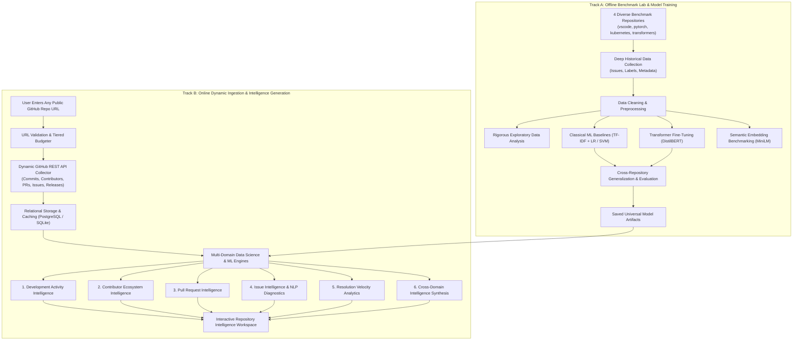

# OpenSourceLens — Project Methodology

## 1. Overview & Dual-Track Methodology

OpenSourceLens is an intelligent, data science-powered GitHub repository intelligence platform. Its methodology is structured into two complementary operational tracks:

- **Track A (Offline Benchmark Lab & Machine Learning Foundation):** Utilizes four diverse, high-volume open-source repositories (`microsoft/vscode`, `pytorch/pytorch`, `kubernetes/kubernetes`, `huggingface/transformers`) as rigorous testbeds. In this track, data collection is exhaustive, enabling deep exploratory data analysis, systematic baseline modeling, hyperparameter search, transformer fine-tuning, dense vector retrieval calibration, and formal cross-repository generalization testing. The outputs of Track A are saved universal model weights, tokenizers, vectorizers, and empirical baselines.
- **Track B (Online Dynamic Ingestion & Intelligence Generation):** Operates on-demand when an end-user inputs any arbitrary public GitHub repository. In this track, a tiered API crawler dynamically collects bounded snapshots across five repository entities (commits, contributors, pull requests, issues, releases), stores and caches the data in the relational database, runs domain-agnostic statistical and NLP models, and generates an evidence-backed intelligence report within a responsive web workspace.

---

## 2. Track A: Offline Benchmark Lab Methodology

### 2.1 Benchmark Repository Selection & Stratification
The benchmark corpus is selected to represent distinct software engineering domains, governance models, issue volumes, and triage dynamics:
- `microsoft/vscode`: Rapid-triage developer tools and GUI application.
- `pytorch/pytorch`: High-volume, compute-heavy machine learning framework.
- `kubernetes/kubernetes`: Distributed systems and cloud-native infrastructure with multi-SIG governance.
- `huggingface/transformers`: Rapidly evolving deep learning and NLP open-source library.

### 2.2 Corpus Construction & Data Hygiene
- **Raw Data Preservation:** Raw API JSON payloads are saved immutably in `data/raw/` with timestamps and commit SHAs to guarantee scientific reproducibility.
- **Noise Stripping & Text Normalization:** HTML tags, Markdown tables, code blocks, URLs, and image links are parsed and extracted. Code blocks and stack traces are flagged as structured binary features rather than discarded blindly.
- **Universal Label Normalization:** Repository-specific label names (e.g., `kind/bug`, `type: bug`, `bugfix`) are mapped using regex patterns into a canonical 3-class target taxonomy (`bug`, `feature`, `other`), verified against maintainer tags.
- **Leakage Prevention:** Issues closed within 60 seconds (bot auto-triage, spam, immediate closure) are segregated. Explicit label strings are stripped from the issue text body before training to prevent circular feature leakage.
- **Dataset Partitioning:** Stratified splitting is performed across repositories and canonical classes into Training (70%), Validation (15%), and Test (15%) partitions. In addition, Leave-One-Repository-Out (LORO) cross-validation is conducted to measure out-of-domain generalization.

### 2.3 Exploratory Data Analysis (EDA)
Comprehensive exploratory data analysis investigates:
- Vocabulary distributions, word frequency, and TF-IDF sparsity.
- Class distribution and severe imbalance ratios.
- Longitudinal issue creation and closure trajectories.
- Comment counts, author associations (Maintainer vs Contributor vs First-time), and interaction patterns.
- Kaplan-Meier survival curves and empirical resolution-time distributions.

### 2.4 Supervised Issue Classification
Supervised classification evaluates whether NLP representations can generalize across repositories:
1. **Classical ML Baselines:**
   - Preprocessing: Word tokenization, stop-word removal, sublinear TF-IDF vectorization (1-2 n-grams, 10,000 max features).
   - Models: L2-regularized Logistic Regression and Linear Support Vector Classifier (LinearSVC).
   - Hyperparameter Optimization: 5-fold cross-validation grid search over regularization strengths ($C$).
2. **Deep Learning & Transformer Fine-Tuning:**
   - Architecture: Pretrained `distilbert-base-uncased` (66.9M parameters) fine-tuned for sequence classification.
   - Tokenization: WordPiece tokenizer with maximum sequence length of 256 tokens (truncated title + description).
   - Training: AdamW optimizer with linear learning rate warmup and decay ($lr = 2 \times 10^{-5}$), weight decay 0.01, cross-entropy loss with inverse-frequency class weights to counter imbalance.
3. **Evaluation Protocol:**
   - Metrics: Overall Accuracy, Macro-averaged Precision, Recall, and F1-score (to prevent majority-class masking).
   - Error Diagnostics: Confusion matrices, per-class error breakdowns, and inspection of high-confidence false predictions.

### 2.5 Semantic Similarity & Dense Retrieval
1. **Embedding Generation:** Pretrained Sentence-Transformers (`all-MiniLM-L6-v2`) map cleaned issue text into 384-dimensional dense vectors with unit L2-norm.
2. **Cosine Similarity Space:** Pairwise cosine similarity is computed via dot products:
   $$\text{sim}(u, v) = \frac{u \cdot v}{\|u\|_2 \|v\|_2} = u \cdot v$$
3. **Threshold Calibration:** Cosine similarity thresholds are empirically calibrated (e.g., $\ge 0.70$ for related issues, $\ge 0.85$ for potential duplicates) using duplicate issue references (`closes #`, `duplicate of`) as proxy ground truth.

### 2.6 Issue Resolution Velocity Modeling
- Quantitative modeling of resolution duration ($t_{\text{close}} - t_{\text{create}}$).
- Log-transformed duration regression and Random Forest velocity classification across SLA speed tiers:
  - Rapid: $< 1$ day
  - Standard: $1 - 7$ days
  - Moderate: $7 - 30$ days
  - Prolonged: $> 30$ days
- Rigorous feasibility assessment evaluating feature importance (e.g., maintainer involvement, author association, code blocks) and establishing limitations when applied across disparate repositories.

---

## 3. Track B: Online Dynamic Ingestion & Intelligence Generation Methodology

Track B executes when an end-user provides any eligible public GitHub repository URL (e.g., `https://github.com/facebook/react`).

### 3.1 Dynamic Ingestion & Validation
1. **Input Normalization & Validation:** Validates URL syntax, extracts `owner` and `repo`, and verifies eligibility via GitHub API:
   - Exists and is public.
   - Not an empty fork.
   - Has minimum activity (e.g., $\ge 5$ commits, $\ge 5$ issues/PRs).
2. **Tiered API Rate-Limit Budgeter:** Allocates GitHub REST API requests proportionally within an authenticated budget (5,000 requests/hour/token):
   - Fast Snapshot Mode: $\le 100$ issues, 100 PRs, 100 commits.
   - Standard Diagnostic Mode: Up to 500 issues, 300 PRs, 300 commits, 100 contributors.
3. **Relational Ingestion & Upsert:** Data is validated with Pydantic schemas and upserted into PostgreSQL/SQLite tables (`repositories`, `commits`, `contributors`, `pull_requests`, `issues`, `issue_labels`).

### 3.2 Analytical Domain Methodologies

#### Domain 1: Development Activity Intelligence
- **Time-Series Aggregation:** Commits and releases are aggregated into weekly and monthly temporal buckets.
- **Trend Decomposition:** Rolling averages (4-week and 12-week) and linear trend lines identify whether development is accelerating, steady, or declining.
- **Anomaly & Change-Point Detection:** Z-score and interquartile range (IQR) outlier detection on weekly commit counts flag sudden activity surges, freezes, or major sprint milestones.
- **Cadence & Burstiness:** Computes coefficient of variation ($CV = \sigma / \mu$) and burstiness metrics to quantify regularity versus irregular bursts.

#### Domain 2: Contributor Ecosystem Intelligence
- **Gini Coefficient & Lorenz Curve:** Measures contribution concentration across all contributors:
  $$G = \frac{\sum_{i=1}^{n} \sum_{j=1}^{n} |x_i - x_j|}{2n^2 \bar{x}}$$
  A high Gini ($> 0.80$) indicates extreme concentration (risk of low bus factor), while a lower Gini indicates a decentralized community.
- **Contribution Entropy:** Normalized Shannon entropy of commit distribution:
  $$H = -\sum_{i=1}^{n} p_i \log_2(p_i) / \log_2(n)$$
- **Core vs. Peripheral Segmentation:** Categorizes contributors into:
  - *Core:* Top 10% contributing $\ge 70\%$ of total commits/PRs.
  - *Regular:* Consistent monthly contributions.
  - *Casual/One-time:* Single contribution.
- **Contributor Retention & Churn:** Evaluates first-commit vs. last-commit timestamps to measure contributor half-life and newcomer drop-off rates.

#### Domain 3: Pull Request Intelligence
- **PR Lifecycle Timelines:** Measures duration from creation to first review, review to merge, and overall turnaround time.
- **Merge Ratio & Abandonment Rate:** Computes proportion of PRs merged, closed unmerged, or lingering open ($> 60$ days).
- **PR Backlog Growth:** Compares monthly PR creation rate versus merge rate to calculate net backlog accumulation.
- **Review Bottleneck Detection:** Identifies PRs waiting disproportionately long for first maintainer review based on file change volume (lines added/deleted).

#### Domain 4: Issue Intelligence & NLP Diagnostics
- **Universal Zero-Shot & Fine-Tuned Classification:** Issue titles and bodies are classified into `bug`, `feature`, and `other` using the universal DistilBERT model trained in Track A.
- **Dynamic Semantic Retrieval:** Newly ingested issues are vectorized on-the-fly using `all-MiniLM-L6-v2` and cached. Users can query any issue to find the top-$K$ most semantically related historical issues within the same repository.
- **Backlog Inflow vs Outflow:** Net issue accumulation rates are tracked over time.
- **Aging & Staleness Distribution:** Open issues are binned by age ($< 30$d, $30-90$d, $90-365$d, $> 1$yr) to highlight backlog stagnation.

#### Domain 5: Resolution Velocity Analytics
- **Continuous Turnaround Statistics:** Calculates mean, median, IQR, 90th percentile, and Kaplan-Meier 30-day resolution probability for the repository.
- **Speed Tier Distribution:** Categorizes resolution into $< 1$ day, $1-7$ days, $7-30$ days, and $> 30$ days.
- **Comparative Baseline Benchmarking:** Compares the repository's median resolution velocity against empirical distributions established across the benchmark corpus.

#### Domain 6: Cross-Domain Intelligence Synthesis & Findings Report
- **Multi-Signal Correlation:** Synthesizes indicators across Activity, Contributors, PRs, and Issues (e.g., surging issue inflow combined with declining PR review velocity and high contributor concentration).
- **Automated Evidence-Backed Narrative Findings:** Generates objective diagnostic observations:
  - *Triage Health:* Rapid response rate vs aging backlog.
  - *Ecosystem Resilience:* Bus-factor risk assessment based on Gini coefficient and core maintainer dependency.
  - *Review Responsiveness:* Average time-to-merge and review backlog trends.
  - *Development Momentum:* 90-day activity trajectory (accelerating, stable, slowing).

---

## 4. Generalization & Cross-Repository Validation Protocol

To ensure models and analytical metrics generalize beyond the four initial repositories:

1. **Domain-Agnostic Feature Extraction:** No repo-specific dummy variables (`repo_name_vscode`) or ecosystem-specific keyword rules are used in inference pipelines.
2. **Leave-One-Repository-Out (LORO) Evaluation:** Models trained on 3 benchmark repositories are evaluated on the 4th held-out repository to simulate performance on a completely novel codebase.
3. **Open-Vocabulary NLP:** The DistilBERT WordPiece tokenizer breaks unseen library names and technical terminology into universal subword tokens.
4. **Normalized Comparative Baselines:** Rather than reporting raw metrics in a vacuum, repository indicators are evaluated as percentile ranks against standardized benchmark distributions.

---

## 5. Methodological Principles & Scientific Integrity

- **Raw Data Separation:** Raw API responses are preserved immutably and never overwritten by transformed data.
- **No Hallucinated Metrics:** Every statistic, chart point, percentile, and insight presented in the UI is derived mathematically from collected GitHub data.
- **Explicit Uncertainty & Scope:** If a repository has too few issues or commits to perform statistically valid survival analysis or trend decomposition, the platform explicitly displays sample-size caveats rather than fabricating results.
- **Honest ML Framing:** Related-issue detection is presented as semantic retrieval of *potentially* related discussions, never as guaranteed duplicate detection. Issue classification probabilities are surfaced as model confidence scores, not absolute ground truth.
- **Privacy & Compliance:** Only publicly available GitHub data is ingested. Private tokens are used strictly to satisfy rate-limiting and are never logged or stored.
