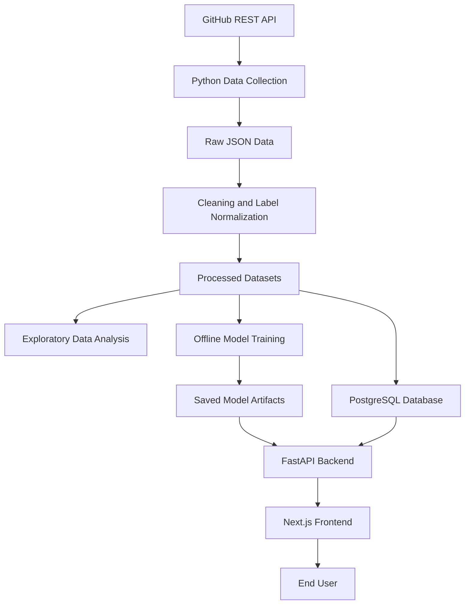

# OpenSourceLens — System Architecture

## 1. Overview

OpenSourceLens is an intelligent GitHub repository analytics platform that combines data science, classical machine learning, natural language processing, transformer-based deep learning, and semantic retrieval.

The system will collect and process GitHub repository data, generate analytical insights, evaluate ML/NLP models, and expose the resulting capabilities through an interactive web application.

The architecture separates data collection, offline model training, structured data storage, backend inference, and frontend presentation.

## 2. Technology Stack

| Component | Technology | Purpose |
|---|---|---|
| Frontend | Next.js + TypeScript | Interactive web application |
| Backend | FastAPI + Python | API endpoints and business logic |
| Database | PostgreSQL | Structured repository and issue data |
| Data manipulation | Pandas | Cleaning, transformation, and analysis |
| Classical ML | scikit-learn | TF-IDF, Logistic Regression, and SVM |
| Deep learning | PyTorch | Model training and inference |
| Transformer models | Hugging Face Transformers | Transformer-based issue classification |
| Semantic retrieval | Sentence Transformers | Issue embeddings |
| Data visualization | A suitable React charting library | Display analytics in the dashboard |
| Data source | GitHub REST API | Repository and issue collection |

Specific library versions and deployment services will be selected during implementation.

## 3. High-Level Architecture

The system will follow this architecture:



The diagram represents the planned data and application flow. Model training will be separate from normal prediction requests.

## 4. Frontend Architecture

The frontend will be implemented using Next.js and TypeScript.

Its responsibilities will include:

- Providing a repository input or selection interface
- Displaying repository overview statistics
- Presenting issue analytics and charts
- Allowing users to submit issue text for classification
- Displaying predicted issue categories
- Showing potentially related issues
- Presenting resolution-time analytics
- Handling loading states, API errors, and empty results
- Providing a responsive user interface

The frontend will communicate with the FastAPI backend through HTTP API requests.

It will not independently train or execute the machine-learning models.

## 5. Backend Architecture

The backend will use FastAPI and Python.

Its responsibilities will include:

- Exposing API endpoints
- Validating incoming requests
- Retrieving repository and issue information from PostgreSQL
- Running analytical queries or retrieving prepared analytics
- Loading trained model artifacts
- Performing issue classification
- Retrieving potentially related issues
- Providing resolution-analysis results
- Handling invalid requests and processing errors

The backend will separate API routing, business logic, database access, and ML/NLP inference into manageable modules.

## 6. Data Collection and Processing

A Python-based data pipeline will collect information from the GitHub REST API.

The collection process will support:

- Repository metadata
- Issue metadata
- Issue titles and descriptions
- Labels
- Creation, update, and closure timestamps
- Comment data where required

The collected API responses will be preserved as raw data.

A preprocessing pipeline will then clean the data, handle missing values, normalize labels, construct analytical features, and prepare datasets for EDA and model training.

Raw data and processed datasets will remain separate.

## 7. Database Architecture

PostgreSQL will store structured information required by the application.

The planned entities include:

- Repositories
- Issues
- Issue labels
- Issue comments, where required
- Derived analytical information where useful

A repository may contain many issues, and an issue may have multiple labels and comments.

Database relationships and constraints will be finalized during the database design phase.

Large raw API dumps, training datasets, and model checkpoints will not automatically be stored as database records. Their storage format and location will be selected according to their intended use.

## 8. Machine-Learning Architecture

Model development will occur offline using prepared datasets.

### 8.1 Classical Classification

The first classification baseline will use:

- Text preprocessing
- TF-IDF feature extraction
- Logistic Regression

A Support Vector Machine will also be evaluated.

The fitted text vectorizer and classifier will be saved as model artifacts.

### 8.2 Transformer Classification

A pretrained transformer model, such as DistilBERT or BERT, will be fine-tuned for issue classification.

The final architecture will depend on dataset quality, computational resources, and experimental results.

The trained model and its required tokenizer and configuration will be saved for inference.

### 8.3 Model Comparison

The classical and transformer-based classifiers will be evaluated on suitable held-out data.

Metrics will include precision, recall, F1-score, macro-F1, accuracy, and a confusion matrix.

The best model for application use will be selected based on measured performance and practical resource requirements.

## 9. Related-Issue Detection Architecture

Related-issue detection will use semantic embeddings and similarity-based retrieval.

The planned process is:

1. Prepare the text of candidate issues.
2. Generate sentence embeddings.
3. Persist the embeddings so they do not need to be regenerated for every request.
4. Generate an embedding for the selected issue.
5. Compare it with candidate issue embeddings using cosine similarity.
6. Rank candidates and return the top-K results.

The initial implementation may use NumPy or scikit-learn for similarity calculations.

The issue metadata will be retrieved from the database. The embedding storage and retrieval mechanism may be improved if dataset size or performance requirements justify it.

Results will be presented as potentially related issues rather than guaranteed duplicates.

## 10. Resolution Analysis Architecture

Resolution analysis will use issue timestamps and relevant metadata.

For closed issues, resolution time will initially be calculated as:

`resolution_time = closed_at - created_at`

The analytical component will generate statistics and comparisons such as:

- Average and median resolution time
- Resolution-time distributions
- Resolution time by category
- Resolution time across repositories
- Factors associated with differences in resolution time

The initial version will focus on descriptive analysis. Resolution-time prediction will remain optional until the dataset is evaluated.

## 11. Offline Training and Online Inference

Model training and application inference will be separate workflows.

### Offline Training

```text
Processed Dataset
        ↓
Model Training
        ↓
Model Evaluation
        ↓
Save Model Artifacts
```

### Online Inference

```text
Frontend Request
        ↓
FastAPI Endpoint
        ↓
Load or Reuse Trained Model
        ↓
Prediction or Retrieval
        ↓
API Response
        ↓
Frontend Result
```

Models should be loaded and reused rather than retrained for every incoming request.

The deployment environment must provide sufficient memory and computing resources for the selected models.

## 12. API Responsibilities

The backend is expected to expose endpoints for the following capabilities:

| Endpoint Purpose | Responsibility |
|---|---|
| Repository overview | Return repository statistics |
| Issue analytics | Return issue counts, trends, and distributions |
| Issue classification | Predict a category from issue text |
| Related issues | Retrieve potentially related issues |
| Resolution analytics | Return resolution statistics and comparisons |
| Health check | Indicate whether the backend is available |

Exact endpoint paths, request schemas, and response schemas will be defined during backend implementation.

## 13. Proposed Project Structure

```text
OpenSourceLens/
├── frontend/
│   ├── app/
│   ├── components/
│   ├── lib/
│   └── public/
├── backend/
│   ├── app/
│   │   ├── main.py
│   │   ├── api/
│   │   ├── services/
│   │   ├── database/
│   │   └── schemas/
│   └── requirements.txt
├── data/
│   ├── raw/
│   ├── processed/
│   └── README.md
├── ml/
│   ├── data_collection/
│   ├── preprocessing/
│   ├── eda/
│   ├── classification/
│   ├── related_issues/
│   └── resolution_analysis/
├── models/
├── docs/
├── .gitignore
├── .env.example
└── README.md
```

This is a proposed organizational structure. It may be refined when implementation begins.

Large datasets, model weights, environment files containing secrets, and temporary artifacts should be excluded from version control unless there is a specific reason to track them.

## 14. Security and Configuration

The system will follow these principles:

- Store credentials and API tokens in environment variables or an appropriate secrets manager.
- Never commit real secrets to Git.
- Validate and constrain user-supplied repository identifiers and issue text.
- Configure frontend-to-backend CORS appropriately.
- Handle API failures and invalid input safely.
- Avoid exposing unnecessary user or repository metadata.
- Apply sensible request limits to expensive model-inference endpoints.

## 15. Deployment Architecture

The application will eventually be deployed using suitable hosting services.

The deployed system will contain:

- A hosted Next.js frontend
- A hosted FastAPI backend
- A PostgreSQL database
- Required model artifacts and inference dependencies

Deployment services will be selected later based on cost, available resources, model size, and ease of integration.

The deployment must provide enough memory and processing capacity for the chosen transformer model.

## 16. Architectural Principles

The architecture will follow these principles:

- Keep frontend, backend, data processing, and model training responsibilities separate.
- Reuse the same evaluated model artifacts for application inference.
- Preserve raw data separately from processed data.
- Keep data collection reproducible.
- Use PostgreSQL for structured application data.
- Persist embeddings instead of regenerating them for every retrieval request.
- Avoid unnecessary architectural complexity in the initial implementation.
- Expand the architecture only when demonstrated requirements justify it.

## 17. Expected Outcome

The expected outcome is a modular, understandable, and deployable architecture that integrates GitHub data collection, data science, classical machine learning, transformer-based classification, semantic retrieval, and resolution analytics into a single web application.

The architecture is designed to support incremental implementation, testing, evaluation, and deployment.
