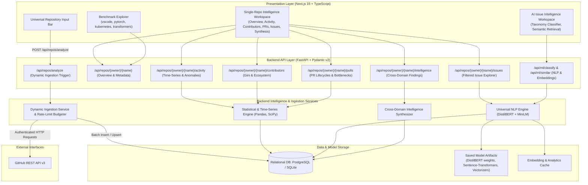

# OpenSourceLens — System Architecture Specification

## 1. Executive Summary & Architectural Vision

OpenSourceLens is an intelligent, data science-powered GitHub repository intelligence platform. The architecture is engineered to decouple offline data science experimentation from online, high-performance web analytics.

The system serves two complementary operational modes:
1. **Offline Benchmark Lab (Track A):** Ingests, processes, and trains machine learning models on four diverse, high-volume software engineering repositories (`microsoft/vscode`, `pytorch/pytorch`, `kubernetes/kubernetes`, `huggingface/transformers`), outputting universal model weights, tokenizers, and benchmark distributions.
2. **Online Dynamic Intelligence Platform (Track B):** Allows an end-user to input **any eligible public GitHub repository URL**, dynamically collects and normalizes its available commits, contributors, pull requests, issues, and releases within rate-limit budgets, persists them into relational storage, runs multi-domain statistical and NLP models, and presents interactive visualizations and evidence-backed intelligence findings.

---

## 2. Technology Stack

| Layer | Component | Technologies | Architectural Purpose |
|---|---|---|---|
| **Frontend** | Presentation Layer | **Next.js 15.5** (React 19, TypeScript 5.7), Tailwind CSS 3.4, Lucide Icons | Responsive UI, server/client components, dynamic URL routing |
| | Visualizations | **Recharts 3.10** | Interactive area charts, grouped bar charts, Lorenz curves, doughnut distributions |
| **Backend** | API Gateway & Service | **FastAPI 0.162**, Pydantic v2, Uvicorn | High-concurrency asynchronous REST endpoints, request validation |
| | ORM & Persistence | **SQLAlchemy 2.0**, Alembic | Generic relational data access, migration management, connection pooling |
| **Database** | Primary Relational Store | **PostgreSQL** (Production target) / **SQLite** (Local WAL mode) | Normalized storage of repositories, commits, contributors, PRs, issues, analytics |
| **Data Ingestion** | Dynamic GitHub Collector | Python `httpx`, `asyncio`, GitHub REST API v3 | Bounded ingestion, rate-limit budgeting, pagination, retry with exponential backoff |
| **Data Science & ML** | Classical Analytics & Stats | **Pandas 2.2**, **NumPy**, **SciPy**, **Statsmodels** | Time-series aggregation, Gini concentration, anomaly detection, descriptive metrics |
| | Classical ML Baselines | **scikit-learn 1.4** | TF-IDF text representations, Logistic Regression, Linear SVM |
| | Deep Learning & NLP | **PyTorch 2.14**, **Hugging Face Transformers 4.49** | Universal fine-tuned `distilbert-base-uncased` sequence classifier |
| | Dense Semantic Retrieval | **Sentence Transformers 3.4** (`all-MiniLM-L6-v2`) | 384-dimensional dense vector embeddings, cosine similarity search |

---

## 3. High-Level Architecture Diagram

---

## 4. Subsystem Specifications

### 4.1 Ingestion & Budgeting Engine (`backend/app/services/ingestion_service.py`)
- **URL Parser & Validator:** Validates repository identifiers, canonicalizes input into `{owner}/{repo}`, and verifies existence via `GET /repos/{owner}/{repo}` before allocating collection quota.
- **Rate-Limit Budgeter:** Inspects `X-RateLimit-Remaining` and `X-RateLimit-Reset` headers. Dynamically adjusts collection depth:
  - *Fast Snapshot Mode:* Collects metadata, 100 recent commits, 100 contributors, 100 PRs, 100 issues ($\sim 6$ API calls).
  - *Standard Diagnostic Mode:* Collects up to 500 issues, 300 PRs, 300 commits, and 100 contributors ($\sim 25$ API calls).
- **Asynchronous ETL:** Uses non-blocking asynchronous requests (`httpx`), concurrent pagination with backoff, and validates payloads using Pydantic schemas before upserting into the relational database.
- **Freshness & Cache Control:** Enforces a configurable TTL (e.g., 24 hours). If a repository was ingested within the TTL window, cached analytical snapshots are returned instantly without consuming API rate limits.

### 4.2 Database Layer (`backend/app/database/`)
The database schema utilizes generic, normalized entity tables. Tables are never partitioned or hardcoded per repository:
- `repositories`: Identity, metadata, stars, forks, language, timestamps, ingestion status.
- `commits`: Repository commits, authors, dates, message summaries, addition/deletion stats.
- `contributors`: Contributors, login, commit counts, first and last contribution dates.
- `pull_requests`: PR numbers, titles, states, authors, creation/closure/merge timestamps, time-to-merge, comment counts, lines changed.
- `issues`: Issue numbers, titles, bodies, cleaned text, states, authors, creation/closure timestamps, comment/reaction counts, canonical labels, velocity speed tiers.
- `issue_labels`: Original GitHub labels mapped to canonical taxonomies.
- `repository_analytics`: Precomputed time-series snapshots, summary statistics, and health indicators.
- `related_issues_cache`: Precalculated semantic similarity pairs for high-frequency queries.
- `predictions`: Inference audit log tracking model version, input, output, confidence, and latency.

### 4.3 Multi-Domain Intelligence Services
1. **Activity Intelligence (`backend/app/services/activity_service.py`):**
   - Aggregates commits and releases into weekly/monthly time series.
   - Computes rolling moving averages and trends.
   - Detects burstiness, anomalies, and sudden changes in development velocity.
2. **Contributor Intelligence (`backend/app/services/contributor_service.py`):**
   - Calculates Gini coefficient and Lorenz curve coordinates for commit distribution.
   - Computes Shannon entropy of community contributions.
   - Performs core vs. peripheral contributor segmentation.
   - Measures newcomer activity and contributor retention half-life.
3. **Pull Request Intelligence (`backend/app/services/pr_service.py`):**
   - Analyzes lifecycle metrics: time-to-first-review, time-to-merge, and abandonment rates.
   - Identifies PR backlog growth and review bottlenecks.
4. **Issue Intelligence & NLP (`backend/app/services/issue_service.py` & `ml_service.py`):**
   - Applies universal fine-tuned DistilBERT to classify issues into `bug`, `feature`, and `other`.
   - Embeds issue text using `all-MiniLM-L6-v2` and computes pairwise cosine similarity for duplicate and related-issue retrieval.
   - Computes backlog inflow/outflow balance and aging distribution.
5. **Resolution Velocity Service (`backend/app/services/resolution_service.py`):**
   - Calculates empirical resolution turnaround percentiles (P25, P50, P75, P90) and Kaplan-Meier survival estimates.
   - Benchmarks repository speed tiers against empirical distributions from the benchmark corpus.
6. **Cross-Domain Intelligence Synthesizer (`backend/app/services/intelligence_service.py`):**
   - Correlates signals across all five domains to produce evidence-backed findings (e.g., "High contributor concentration combined with rising issue backlog indicates potential maintenance bottleneck").

### 4.4 Presentation Layer (Next.js 15 Frontend)
The frontend is structured around dynamic routing and modular intelligence dashboards:
- **`src/app/page.tsx`:** Landing page featuring the **Universal Repository Input Bar**, real-time validation feedback, and quick-start links to benchmark repositories.
- **`src/app/repos/[owner]/[name]/page.tsx`:** Dynamic single-repository intelligence workspace, containing six tabbed domain views:
  1. *Overview Tab:* High-level health scorecard, repository metadata, activity sparks.
  2. *Development Activity Tab:* Time-series commit velocity, release cadence, anomaly flags.
  3. *Contributor Ecosystem Tab:* Lorenz curve, Gini coefficient gauge, core vs. peripheral breakdown.
  4. *Pull Request Intelligence Tab:* Time-to-merge distribution, review velocity, bottleneck warnings.
  5. *Issue Intelligence Tab:* Full-text searchable issue explorer, taxonomy distribution, age breakdown.
  6. *Intelligence Report Tab:* Synthesized cross-domain diagnostic findings and actionable recommendations.
- **`src/app/analyzer/page.tsx`:** Interactive AI playground allowing users to input arbitrary issue text to test DistilBERT classification and dense semantic retrieval.
- **`src/app/analytics/page.tsx`:** Ecosystem benchmark matrix comparing the 4 baseline repositories.

---

## 5. Offline Model Serving & Caching Architecture

To guarantee low latency and resource efficiency:
- **Singleton Model Lifecycle:** PyTorch models (DistilBERT) and Sentence-Transformer embedding pipelines are loaded into memory once during FastAPI startup (`@asynccontextmanager` in `backend/app/main.py`) and held in CPU/GPU memory for instant inference.
- **Vector Caching:** When a repository is dynamically ingested, issue embeddings are computed in batch mode using `all-MiniLM-L6-v2` and cached as float32 NumPy arrays in memory/filesystem (`data/embeddings/{owner}_{name}.npy`), enabling sub-50ms cosine similarity queries.
- **Inference Fallback:** If deep learning dependencies or GPU acceleration are constrained, the system falls back seamlessly to the calibrated TF-IDF + LinearSVC classical pipeline without interrupting the user experience.

---

## 6. Security, Rate Limiting & Error Handling

- **Authentication & Secrets:** GitHub personal access tokens (`GITHUB_TOKEN`) are loaded from `.env` and never exposed to the frontend or written to git.
- **Input Sanitization:** Repository owner and name parameters are strictly validated against GitHub's slug format (`^[a-zA-Z0-9_.-]+$`).
- **Defensive API Degradation:** If GitHub API rate limits are approached, the dynamic ingestion engine gracefully falls back to cached data or reduces collection depth, notifying the user with clear diagnostic alerts.
- **CORS & Origin Isolation:** Backend restricts cross-origin resource sharing to designated frontend origins.

---

## 7. Deployment Architecture

The application is structured for containerized production deployment:
- **Frontend Container:** Standalone Next.js Node.js server or edge deployment on Vercel/Node.
- **Backend Container:** Dockerized FastAPI service running via Uvicorn with multi-worker support.
- **Database Service:** Managed PostgreSQL instance with persistent storage and connection pooling.
- **Persistent Volume:** Dedicated storage for model weights (`models/`) and precomputed vector caches (`data/embeddings/`).
