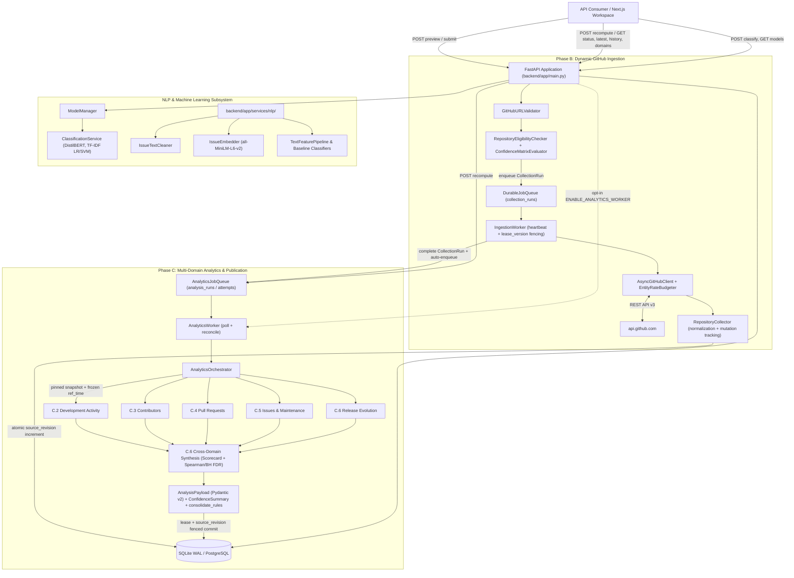

# OpenSourceLens — System Architecture

OpenSourceLens is a universal **GitHub Repository Intelligence and Analytics Platform** (see [product-vision.md](./product-vision.md)). The backend is a multi-stage asynchronous pipeline built on **FastAPI**, **SQLAlchemy 2.0**, **Alembic**, **PyTorch / Hugging Face Transformers / Sentence-Transformers**, and a seven-domain statistical analytics engine (`methodology_version = "2026.2"`).

> **System State Post-Stage 3:** The **Phase B** dynamic ingestion subsystem and multi-domain statistical analytics subsystem are operational in `backend/` across 7 analytical domains (Development Activity, Contributors, Pull Requests, Issues, Release Evolution, Discussions Intelligence, and Cross-Domain Synthesis). Rich PR depth, git tags fallback, and GitHub Discussions (GraphQL API v4) are fully wired and tested. Stage 4 will deliver generalized ML/NLP pipelines and the single-repository workspace UI.

---

## 1. End-to-End Architecture Diagram

---

## 2. FastAPI Application Structure

The FastAPI application is constructed in [`backend/app/main.py`](../backend/app/main.py) (`create_application()`, `lifespan()`):

- **Configuration & Error Envelopes:** [`backend/app/core/config.py`](../backend/app/core/config.py) reads CORS and optional worker settings; [`backend/app/core/error_handlers.py`](../backend/app/core/error_handlers.py) and [`backend/app/core/exceptions.py`](../backend/app/core/exceptions.py) normalize domain errors, SQLAlchemy failures, HTTP exceptions, and validation errors into structured `ErrorResponse` / `ValidationErrorResponse` JSON envelopes.
- **Router Mounting:**
  - `GET /` and `GET /health` live directly on `app`.
  - [`backend/app/api/v1/api.py`](../backend/app/api/v1/api.py) mounts `/api/v1/ping`, `/api/v1/analytics`, `/api/v1/classify`, `/api/v1/models`, and `/api/v1/ingest`.
  - [`backend/app/main.py`](../backend/app/main.py#L124) also mounts `ingest_router` directly at `/api/ingest`.
- **Startup Lifespan:** Verifies DB readiness, runs `Base.metadata.create_all(bind=engine)` via `init_db()`, optionally prewarms ML artifacts if `PREWARM_ON_STARTUP=true`, and optionally starts an in-process background `AnalyticsWorker` task when `ENABLE_ANALYTICS_WORKER=true`.

---

## 3. Repository Ingestion Pipeline

1. **URL Canonicalization:** [`GitHubURLValidator.validate_and_canonicalize()`](../backend/app/services/validator.py#L60-L206) parses full URLs, scheme-less URLs (`github.com/owner/repo`), or slugs (`owner/repo`), rejecting reserved GitHub paths, scoped npm-style names (`@org/pkg`), non-GitHub hosts, and malformed owner/repo names.
2. **Pre-Flight Eligibility & Confidence Preview:** [`RepositoryEligibilityChecker`](../backend/app/services/repository_eligibility.py#L30-L279) fetches `/repos/{owner}/{repo}`, gates out private and empty (`size == 0` / `< 1` commit) repositories while allowing forks and archived repos with informational badges, and computes an initial sample sufficiency preview via [`ConfidenceMatrixEvaluator`](../backend/app/services/confidence_matrix.py#L25-L318).
3. **GitHub Client & Budgeting:** [`AsyncGitHubClient`](../backend/app/services/github_client.py#L44-L491) enforces a per-instance concurrency semaphore (`max_concurrency=2`), `100 ms` inter-request pacing, primary rate-limit threshold halting (`X-RateLimit-Remaining < 10`), `Retry-After` handling (`<= 300s` async sleep, `> 300s` structured abort with `resumes_at`), RFC 5988 `Link` pagination, and strict quota checks against [`EntityRateBudgeter`](../backend/app/services/rate_budgeter.py#L53-L183) (`10` requests in `fast_snapshot`, `50` in `standard_diagnostic`).
4. **Normalization & Persistence:** [`RepositoryCollector`](../backend/app/services/repository_collector.py#L118-L1703) harvests metadata, commits (+ optional diff stats within budget), contributors, pull requests, sampled PR reviews, inline PR comments, pure issues (filtering `"pull_request" in item`), issue/PR conversation comments (enforcing mutual parent exclusion), releases, and derived contributor aggregates. It tracks exact `mutated_records` and atomically increments `repositories.analytics_source_revision` whenever analytical source rows change.

See [ingestion.md](./ingestion.md) for the full 12-stage lifecycle, collection modes, and partial-collection semantics.

---

## 4. Durable Queues & Workers

OpenSourceLens uses two SQL-backed durable job queues with monotonic `lease_version` fencing:

- **Ingestion Queue (`DurableJobQueue` + `IngestionWorker`):** Manages `collection_runs` rows (`pending`, `running`, `completed`, `completed_partial`, `rate_limited`, `failed`). `IngestionWorker` renews leases every `15s` inside `process_one_job()` and, upon clean completion (`completed` or `completed_partial` with empty `summary.errors` and `resumes_at is None`), triggers `_enqueue_post_ingestion_analytics()`.
- **Analytics Queue (`AnalyticsJobQueue` + `AnalyticsWorker`):** Manages `analysis_runs` and append-only `analysis_run_attempts` rows (`pending`, `running`, `completed`, `failed`, `cancelled`). Supports active-run partial unique index deduplication, stale-revision superseding (marking superseded runs `status="cancelled"` with attempt `outcome="interrupted"`), lease expiration recovery via `reconcile_analytics_jobs()`, and non-retryable terminal failure handling.

See [workers-and-deployment.md](./workers-and-deployment.md) and [database.md](./database.md) for lease rules, SQLite vs. PostgreSQL concurrency, and execution modes.

---

## 5. Analytics Orchestration, Multi-Domain Engines & Synthesis

[`AnalyticsOrchestrator`](../backend/app/services/analytics/orchestrator.py) coordinates execution for a claimed `AnalysisRun`:

1. Opens a snapshot transaction (`AnalyticsJobQueue.open_analysis_snapshot()`) pinning `analytics_source_revision` and freezing `analysis_reference_time` in UTC.
2. Executes six base calculators implementing [`BaseMetricCalculator`](../backend/app/services/analytics/base.py):
   - `DevelopmentActivityCalculator` (C.2)
   - `ContributorIntelligenceCalculator` (C.3)
   - `PullRequestIntelligenceCalculator` (C.4)
   - `IssueIntelligenceCalculator` (C.5)
   - `ReleaseEvolutionCalculator` (C.6)
   - `DiscussionsIntelligenceCalculator` (Stage 3 / Module 7)
3. Passes the precomputed domain results into `CrossDomainSynthesisCalculator` (C.6), which avoids recomputation while computing the Multi-Domain Diagnostic Scorecard (including the `community_discussions` card), paired calendar-month Spearman Monte Carlo permutation tests (`B=10,000`, `K>=12`, `|r_AR1| > 0.40` suppression, Benjamini-Hochberg FDR `alpha=0.05`), and cross-domain rules.
4. Embeds both `release_evolution` and `discussions_intelligence` inside `repository_synthesis` to strictly preserve the 5-key [`AnalysisPayload`](../backend/app/schemas/analytics_v2.py) Pydantic v2 contract, computes aggregated `coverage_summary` and `confidence_summary` across all 7 domains, consolidates rules via [`consolidate_rules()`](../backend/app/services/analytics/rule_engine.py), and commits atomically via `publish_and_finalize()`.

See [analytics.md](./analytics.md) for exact formulas, thresholds, statistical guards, and rule IDs.

---

## 6. NLP & Machine Learning Subsystem

The ML subsystem provides text intelligence and sequence classification:

- **Issue Categorization (`ClassificationService`):** Fine-tuned DistilBERT (`models/distilbert_finetuned`, 3 classes: `bug`, `feature`, `other`), TF-IDF Logistic Regression, and TF-IDF Linear SVM. Slated for 5-class OOD generalization and post-ingestion scoring in Stage 3.
- **NLP Utilities (`backend/app/services/nlp/`):**
  - `IssueTextCleaner`: Strips code blocks, URLs, markdown formatting, HTML tags, and stack traces with word counts and structural flags.
  - `IssueEmbedder`: Dense vector embedding generation using `all-MiniLM-L6-v2` with lazy loading and L2-normalization for semantic similarity.
  - `classifiers.py`: Classical pipeline representations (`TextFeaturePipeline`, `LogisticRegressionBaseline`, `SVMBaseline`).
- **Retired Legacy Components:** The benchmark-coupled `ResolutionService` (4-repo dummy features) and static `RelatedIssueService` (fixed 2,328-issue lookup table) were removed during Stage 1 cleanup to make way for per-repository semantic duplicate detection.

---

## 7. API Response & Publication Flow

FastAPI serves **Phase C Analytics V2 endpoints** under `/api/v1/analytics/{owner}/{name}/...` (`recompute`, `status`, `latest`, `history`, `runs/{run_id}`, `domains/{domain_key}`) backed directly by `AnalysisRun` and `AnalysisRunAttempt`. See [api.md](./api.md) for complete endpoint contracts and status codes.
