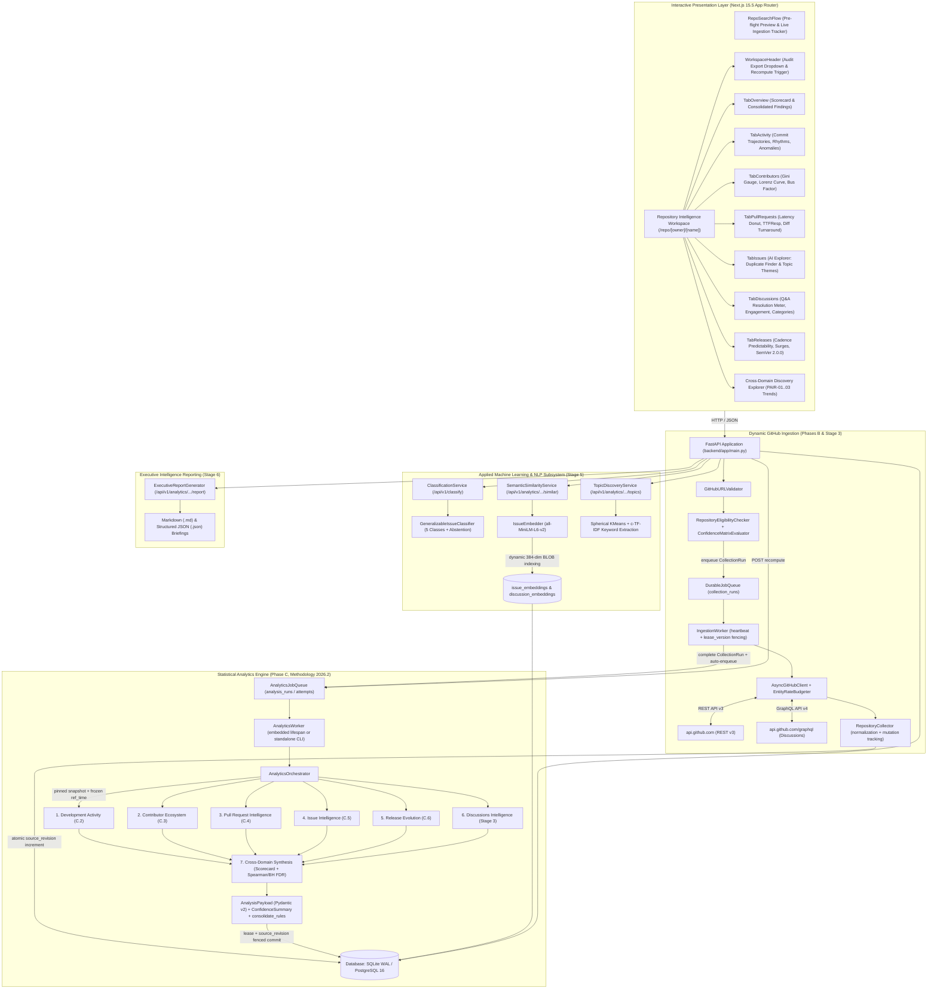

# OpenSourceLens — System Architecture

OpenSourceLens is a universal **GitHub Repository Intelligence and Analytics Platform** (see [product-vision.md](./product-vision.md)). The system is built as a production-grade, asynchronous Data Science and Applied Machine Learning platform pairing a **FastAPI** backend, **SQLAlchemy 2.0 / Alembic** persistence, a seven-domain statistical analytics engine (`methodology_version = "2026.2"`), generalizable **PyTorch / Hugging Face Transformers / Sentence-Transformers** NLP pipelines, and a **Next.js 15.5 App Router** interactive presentation workspace.

> **System State (Stages 1 through 6 Completed):** All architectural tiers are operational. Stages 1 through 6 have delivered prototype cleanup, backend stabilization, entity depth (PR diffs, branches, bodies, draft status), git tags fallback, **GitHub Discussions** (GraphQL API v4), an interactive 7-domain workspace UI, generalizable 5-class NLP issue classification with calibrated abstention, per-repo dynamic semantic duplicate retrieval (`all-MiniLM-L6-v2`), unsupervised Spherical KMeans topic discovery, the Cross-Domain Discovery Explorer, one-click Executive Intelligence Report export (`.md` and `.json`), and a multi-container Docker Compose production stack.

---

## 1. End-to-End Architecture Diagram



---

## 2. FastAPI Application Structure & Lifespan

The backend application is assembled in [`backend/app/main.py`](../backend/app/main.py) via `create_application()`:

- **Environment & Configuration:** [`backend/app/core/config.py`](../backend/app/core/config.py) automatically calls `load_dotenv()`. By default, both `ENABLE_INGESTION_WORKER=true` and `ENABLE_ANALYTICS_WORKER=true` are enabled, running background task loops directly inside the FastAPI lifespan without requiring separate worker terminal processes for local development.
- **Centralized Error Handling:** [`backend/app/core/error_handlers.py`](../backend/app/core/error_handlers.py) normalizes domain exceptions, database errors, and validation failures into standard `ErrorResponse` and `ValidationErrorResponse` JSON envelopes. Public error diagnostics strip local filesystem paths, credentials, and connection URIs via `_sanitize_public_error_message()`.
- **Router Mounting:**
  - `GET /` and `GET /health` are mounted directly on `app`.
  - [`backend/app/api/v1/api.py`](../backend/app/api/v1/api.py) aggregates sub-routers:
    - `/api/v1/ingest`: Dynamic repository preview, submission, and status polling.
    - `/api/v1/analytics`: 7-domain analytics, recompute triggers, semantic similarity, topic discovery, and executive reports.
    - `/api/v1/classify`: Generalizable 5-class issue classification with audit logging.
    - `/api/v1/models`: Model registry status, architecture metadata, and memory prewarming.
    - `/api/v1/health`: System telemetry probe reporting DB ping latency, driver dialect, queue depths, active worker leases, and ML model readiness.
  - Ingestion endpoints are also dual-mounted at `/api/ingest` for backwards compatibility.
- **Startup Lifespan Sequence:**
  1. Verifies database connectivity and dialect latency via `check_connection(engine)`.
  2. Runs `init_db(engine)` to ensure schema availability.
  3. Optionally prewarms transformer and embedding models if `PREWARM_ON_STARTUP=true`.
  4. Launches the embedded `AnalyticsWorker` asyncio task (if `ENABLE_ANALYTICS_WORKER=true`).
  5. Launches the embedded `IngestionWorker` asyncio task (if `ENABLE_INGESTION_WORKER=true`).
  6. On shutdown, signals cancellation events to both background workers, awaits task termination (up to 5.0s timeout), and cleanly disposes the database engine.

---

## 3. Dynamic Ingestion Subsystem (Phase B & Stage 3)

The ingestion pipeline handles any public GitHub repository while strictly protecting against rate-limit exhaustion:

1. **Validation & Canonicalization:** [`GitHubURLValidator.validate_and_canonicalize()`](../backend/app/services/validator.py) accepts full URLs, scheme-less URLs, or `owner/repo` slugs, validating owner names (<= 39 chars, no `--`) and repository names while rejecting reserved paths and npm scopes.
2. **Eligibility Gating & Sample Sufficiency Preview:** [`RepositoryEligibilityChecker`](../backend/app/services/repository_eligibility.py) checks GitHub `/repos/{owner}/{repo}`, requiring repositories to be **public** and **non-empty** (`size > 0` or `commits_count >= 1`). Archived repositories and forks are accepted with informational status flags. [`ConfidenceMatrixEvaluator`](../backend/app/services/confidence_matrix.py) previews data sufficiency expectations and rate budgets.
3. **Budgeted Asynchronous Harvesting:** [`AsyncGitHubClient`](../backend/app/services/github_client.py) enforces a concurrency semaphore (`max_concurrency=2`), pacing (`100 ms`), primary rate-limit safety guards (`X-RateLimit-Remaining < 10`), exponential backoff on HTTP 403/429 (`Retry-After <= 300s`), and quota budgets via [`EntityRateBudgeter`](../backend/app/services/rate_budgeter.py) (`fast_snapshot` <= 10 requests, `standard_diagnostic` <= 50 requests).
4. **Multi-Entity Harvesting Depth:** [`RepositoryCollector`](../backend/app/services/repository_collector.py) harvests:
   - Repository metadata and stars/forks counters.
   - Commits with detailed diff lines (`additions`, `deletions`, `total_changes`).
   - Contributors anchored on `github_id` or unlinked `git_email` (no speculative merging).
   - Pull Requests with depth fields (`body`, `head_branch`, `base_branch`, `is_draft`, `labels`, `requested_reviewers`) and diff churn.
   - Sampled PR formal reviews and inline review comments.
   - Pure issues (filtering `"pull_request" in item`), conversation comments, assignees, and reactions.
   - Releases with automatic git tags fallback (`/tags`) when formal GitHub Releases are absent.
   - **GitHub Discussions** via GraphQL API v4 (querying discussions, categories, Q&A status, marked answers via `answerChosenAt` and `answer { createdAt }`, and comment threads).
5. **Atomic Mutation Tracking:** Populates `mutated_records` and atomically bumps `repositories.analytics_source_revision += 1` only when actual data changes occur.
6. **Automatic Analytics Enqueue:** Upon clean completion of a `CollectionRun`, `_enqueue_post_ingestion_analytics()` automatically enqueues a corresponding `AnalysisRun` in `AnalyticsJobQueue`.

See [ingestion.md](./ingestion.md) for full collection semantics and request budgets.

---

## 4. Multi-Domain Statistical Engine & Synthesis (Phase C, Methodology 2026.2)

Analytical calculations execute under snapshot isolation managed by [`AnalyticsOrchestrator`](../backend/app/services/analytics/orchestrator.py):

1. **Snapshot Isolation & Frozen Reference Time:** Opens a read snapshot pinned to `repository_id` and the worker's claimed `analytics_source_revision`, locking `analysis_reference_time` in UTC.
2. **Seven Analytical Calculators:**
   - **`DevelopmentActivityCalculator` (C.2):** Rolling 4w/12w/52w velocities, completed-week consistency & CV, modified Z-score anomalies, permutation change-points, `7x24` UTC rhythms, diff-aware churn, and commit landing latency.
   - **`ContributorIntelligenceCalculator` (C.3):** Bot isolation, multi-role participation, Gini coefficient, 11-point Lorenz deciles, Shannon entropy, bus factors (`BF50`/`BF80`), and gated retention cohorts.
   - **`PullRequestIntelligenceCalculator` (C.4):** Separated response metrics (`TTFResp`, `TTFR_formal`, `TTFR_inline`), merge vs. abandonment rates, merge latency quantiles, Kaplan-Meier survival curves, diff-size turnaround bins (`small`..`xl`), and reviewer bottlenecks.
   - **`IssueIntelligenceCalculator` (C.5):** Monthly inflow/outflow, pure issue backlog separation, timestamp-derived SLA percentiles, Kaplan-Meier survival (`S(30d)`/`S(60d)`/`S(90d)`), 5-bin open backlog aging, and discussion intensity.
   - **`ReleaseEvolutionCalculator` (C.6):** Cadence predictability (`CV_release`), SemVer 2.0.0 adoption, pre-release commit surges (`14d` vs. `60d`), dormancy, and git tags fallback.
   - **`DiscussionsIntelligenceCalculator` (Stage 3):** Q&A resolution rates, answer latency percentiles (`p50`/`p75`/`p90`/mean), category distributions, community engagement, and contributor bridging.
   - **`CrossDomainSynthesisCalculator` (C.6–C.7):** Assembles the Multi-Domain Diagnostic Scorecard, executes monthly paired Spearman Monte Carlo permutation tests (`B=10,000`, `K>=12`, `|r_AR1| > 0.40` autocorrelation guard, Benjamini-Hochberg FDR `alpha=0.05`), and consolidates deterministic rule interpretations.
3. **Payload Assembly & Publication:** Pydantic v2 validation via [`AnalysisPayload`](../backend/app/schemas/analytics_v2.py), unweighted mean confidence scoring across domains, rule consolidation (`RULE-*`), and optimistic lease-fenced atomic publication to `analysis_runs`.

See [analytics.md](./analytics.md) for formulas, thresholds, and statistical guardrails.

---

## 5. Applied Machine Learning & NLP Subsystem (Stage 5)

OpenSourceLens integrates machine learning strictly where heuristics and statistics fall short—unstructured issue and discussion text:

- **Generalizable 5-Class Issue Categorization:** [`GeneralizableIssueClassifier`](../backend/app/services/nlp/generalizable_classifier.py) classifies issues into `bug`, `feature`, `documentation`, `question`, and `maintenance`. Implements calibrated confidence abstention (`threshold = 0.55`); low-confidence items are classified as `unclassified` with uncertainty flags. Validated via **Leave-One-Repo-Out (LORO)** cross-validation, guaranteeing out-of-distribution transferability to unseen repositories.
- **Dynamic Per-Repository Semantic Duplicate Retrieval:** [`SemanticSimilarityService`](../backend/app/services/nlp/semantic_index_service.py) computes dense 384-dimensional sentence embeddings using `sentence-transformers/all-MiniLM-L6-v2`. Embeddings are L2-normalized and persisted per-repository in `issue_embeddings` and `discussion_embeddings` database tables as raw IEEE-754 binary BLOBs (1,536 bytes per vector). Cosine similarity matching surfaces duplicate and related issues dynamically on demand.
- **Unsupervised Backlog Topic Discovery:** [`TopicDiscoveryService`](../backend/app/services/nlp/topic_discovery_service.py) applies pure-NumPy Spherical KMeans clustering directly on the L2 unit sphere to partition dense issue embeddings into $K \in [3, 8]$ topical clusters. Class-based TF-IDF (c-TF-IDF) extracts top discriminating keywords per cluster, exposing recurring bug areas and feature themes without requiring repo-specific labeled training data.

---

## 6. Interactive Workspace Presentation Layer (Stage 4 & Next.js 15.5)

The frontend is a modern **Next.js 15.5 App Router** application built with React 19, Tailwind CSS 3.4, and Recharts 3.10:

- **Universal Entry (`/`):** [`RepoSearchFlow.tsx`](../frontend/src/components/ingestion/RepoSearchFlow.tsx) allows users to paste any GitHub repository URL or slug, performs pre-flight eligibility gating with instant budget and confidence preview, and displays a live 4-stage ingestion progress tracker with polling.
- **Single-Repository Intelligence Workspace (`/repo/[owner]/[name]`):** Dynamic workspace route serving 7 domain tabs:
  - `TabOverview`: Diagnostic scorecard, health badges, data coverage indicators, and consolidated severity-ordered rule findings.
  - `TabActivity`: Interactive commit velocity trajectory, 4w/12w SMA & EWMA overlays, anomaly and change-point markers, `7x24` UTC rhythm heatmap, and landing latency quantiles.
  - `TabContributors`: Contributor directory, Gini inequality gauge, interactive 11-point Lorenz curve, and bus factor alerts (`BF50`/`BF80`).
  - `TabPullRequests`: Latency comparison (`TTFResp`, `TTFR_formal`, `TTFR_inline`), outcome donut chart, turnaround quantiles, and diff-size turnaround bins.
  - `TabIssues`: Monthly flow chart, resolution SLA quantiles, 5-bin aging distribution, **AI Semantic Duplicate Finder**, and **Discovered Backlog Themes Explorer**.
  - `TabDiscussions`: Q&A resolution meter, answer latency percentiles, category distribution, and top engaged discussion threads.
  - `TabReleases`: Cadence regularity gauge, SemVer 2.0.0 adoption breakdown, and pre-release commit surge comparisons.
- **Cross-Domain Discovery Explorer:** Renders paired monthly time-series alignment charts (`PAIR-01..03`) with dual-axis scaling, permutation test $p$-values, BH FDR $q$-values, and non-causal scientific disclaimers.
- **Executive Audit Export:** [`WorkspaceHeader.tsx`](../frontend/src/components/workspace/WorkspaceHeader.tsx) provides one-click export of synthesized repository audit briefings in Markdown (`.md`) and JSON (`.json`) formats.

---

## 7. Multi-Container Production Deployment Stack (Stage 6)

OpenSourceLens provides a containerized production deployment orchestrated via [`docker-compose.yml`](../docker-compose.yml):

```
                   ┌────────────────────────────────────────┐
                   │          Next.js 15 Frontend           │
                   │        (Port 3000 / osl-frontend)      │
                   └──────────────────┬─────────────────────┘
                                      │ HTTP (Browser / Server)
                                      ▼
                   ┌────────────────────────────────────────┐
                   │         FastAPI Backend Engine         │
                   │        (Port 8000 / osl-backend)       │
                   └──────┬──────────────────────────┬──────┘
                          │                          │
             SQLAlchemy   │                          │  SQLAlchemy
                          ▼                          ▼
┌─────────────────────────────────────────┐  ┌────────────────────────────────────────┐
│         PostgreSQL 16 Alpine DB         │  │     Standalone AnalyticsWorker         │
│         (Port 5432 / osl-postgres)      │◀─┤     (Daemon / osl-analytics-worker)    │
│    Healthchecked via pg_isready         │  └────────────────────────────────────────┘
└─────────────────────────────────────────┘
```

- **`db` (`postgres:16-alpine`):** Production relational engine with persistent volume `osl_pgdata` and internal `pg_isready` healthcheck.
- **`backend` (`Dockerfile.backend`):** FastAPI application running uvicorn in production mode with shared volumes for cached model weights (`osl_models`) and file data (`osl_data`).
- **`analytics_worker` (`Dockerfile.worker`):** Standalone `AnalyticsWorker` daemon processing asynchronous analytical queues with optimistic lease fencing and periodic reconciliation.
- **`frontend` (`Dockerfile.frontend`):** Next.js 15 standalone Node.js production server with SSR support.
- **Telemetry Probes:** Accessible at `GET /health` and `GET /api/v1/health`, exposing database latency, dialect, queue depths, active worker leases, and ML model readiness.

See [workers-and-deployment.md](./workers-and-deployment.md) for full deployment instructions and configuration variables.
