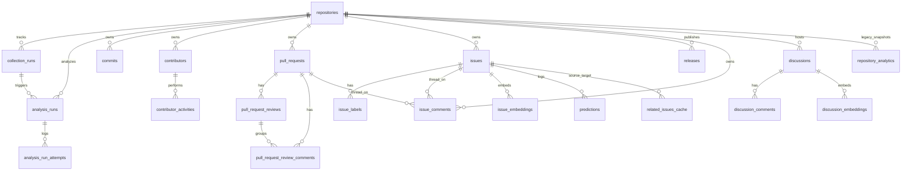

# OpenSourceLens — Database Architecture & Migrations

OpenSourceLens persists repository metadata, ingested GitHub entities, durable job queues, analytical snapshots, dense vector embeddings, and ML audit logs in a relational schema defined with **SQLAlchemy 2.0** ([`backend/app/database/models.py`](../backend/app/database/models.py)) and managed across both **SQLite** (local development/testing) and **PostgreSQL 16** (production Docker container target).

---

## 1. Engine & Session Configuration

Engine creation lives in [`backend/app/database/session.py`](../backend/app/database/session.py):

- **Connection URL Resolution (`get_database_url()`):** Reads `DATABASE_URL` from the environment (normalizing `postgres://` to `postgresql://`), defaulting to local SQLite at `data/opensource_lens.db`.
- **SQLite Configuration (`build_engine()`):** Sets `check_same_thread=False` and attaches a connection listener applying:
  - `PRAGMA journal_mode=WAL` (Write-Ahead Logging for non-blocking concurrent reads)
  - `PRAGMA synchronous=NORMAL` (balanced durability and high write throughput)
  - `PRAGMA foreign_keys=ON` (enforces relational referential integrity)
  - `PRAGMA cache_size=-64000` (64 MB page cache)
- **PostgreSQL Configuration:** Configures SQLAlchemy connection pooling (`pool_size=10`, `max_overflow=20`, `pool_pre_ping=True`) for the `postgres:16-alpine` Docker service.

---

## 2. Tables & Relationships (21 ORM Tables)

The live ORM registers **21 data tables** (plus Alembic's `alembic_version` metadata table):



---

## 3. Comprehensive Table Inventory

### 3.1 Core Repository & Queues

| Table | Purpose | Key Constraints & Indices |
|---|---|---|
| `repositories` | Repository metadata, lifecycle flags (`is_active`, `is_archived`, `is_fork`, `upstream_repo`), sync timestamps, and monotonic revision tracking (`analytics_source_revision`, default `1`). | PK: `id`; Unique `ix_repositories_repo_name(repo_name)`. |
| `collection_runs` | Durable dynamic ingestion job queue and coverage/rate telemetry (`mode`, `status`, `worker_id`, `leased_until`, `lease_version`, `retry_count`, `max_retries=2`, `is_partial`, `coverage_summary`, `items_collected`, `rate_limit_consumed`). | Partial unique index `uq_collection_runs_active_repo` on `(repository_id) WHERE status IN ('pending', 'running')`. |
| `analysis_runs` | Durable Phase C analytics job queue, methodology lineage (`requested_source_revision`, `analytics_source_revision`, `requested_methodology_version`, `methodology_version`, `analysis_reference_time`, `source_content_digest`), leasing (`worker_id`, `leased_until`, `lease_version`), and JSON metrics outputs (`metrics_payload`, `coverage_summary`, `confidence_summary`, `rule_interpretations`). | FK: `repository_id` (`CASCADE`), `collection_run_id` (`SET NULL`). Partial unique index `uq_analysis_runs_active_repo` on `(repository_id) WHERE status IN ('pending', 'running')`. |
| `analysis_run_attempts` | Append-only execution audit log (`attempt_number`, `worker_id`, `started_at`, `completed_at`, `outcome`, `error_category`, `error_message`, `interruption_reason`). | FK: `analysis_run_id` (`CASCADE`). CHECK constraint on `outcome`. Completed attempts reject subsequent mutation (`AttemptImmutableException`). |

### 3.2 Dynamic Ingestion & Rich Entity Streams

| Table | Purpose | Key Constraints & Indices |
|---|---|---|
| `commits` | Commits with author timestamps and diff statistics (`sha`, `author_name/email/login/id`, `author_date`, `committer_date`, `message`, `additions`, `deletions`, `total_changes`). | Unique `uq_commits_repo_sha(repository_id, sha)`. |
| `contributors` | Clean contributor directory anchored on `github_id` or unlinked `git_email`, tracking `primary_role`, counts, `tenure_days`, `is_newcomer`, `is_core`, `is_bot`, `is_unlinked`. | Partial unique indices on `(repository_id, github_id)` and `(repository_id, git_email)`. |
| `contributor_activities` | Normalized event log (`commit`, `pr_opened`, `pr_reviewed`, `issue_opened`, `issue_comment`, etc.). | Unique `(repository_id, activity_type, entity_id)`. |
| `pull_requests` | Pull requests (`pr_number`, `state`, `created_at`, `closed_at`, `merged_at`, turnaround hours, diff stats `additions/deletions/changed_files`, PR depth fields `body`, `head_branch`, `base_branch`, `is_draft`, `labels`, `requested_reviewers`). | Indexed on `(repository_id, state, merged_at)`. Unique `uq_pr_repo_number(repository_id, pr_number)`. |
| `pull_request_reviews` | Formal PR review records (`review_id`, `state`, `submitted_at`, `author`, `author_id`). | Unique `ix_pull_request_reviews_review_id(review_id)`. |
| `pull_request_review_comments` | Inline diff review comments (`comment_id`, `path`, `line`, `commit_id`). | Unique `ix_pull_request_review_comments_comment_id(comment_id)`. |
| `issues` | Pure GitHub issues (`39` columns: cleaned text, evidence flags, speed tiers, SLA resolution hours, censoring flags, assignees, reactions). | Unique `ix_issues_repo_number(repo_name, issue_number)`. FK: `repository_id` (`CASCADE`). |
| `issue_labels` | Mapped canonical labels per issue. | FK: `issue_id -> issues.id` (`CASCADE`). |
| `issue_comments` | Conversation comments linked exclusively to either an issue or a PR. | Unique `comment_id`; CHECK constraint `NOT (issue_id IS NOT NULL AND pull_request_id IS NOT NULL)`. |
| `releases` | Releases and git tags fallback (`release_id`, `tag_name`, `name`, `published_at`, `is_prerelease`, `body`, `is_tag_fallback`, `commit_sha`). | Unique `ix_releases_release_id(release_id)`. |
| `discussions` | GitHub Discussions threads (`discussion_number`, `title`, `body`, `author`, `category_name`, `category_is_answerable`, `is_answered`, `answered_at`, `upvote_count`, `comments_count`). | Indexed on `(repository_id, created_at)` and `(repository_id, is_answered)`. Unique `uq_discussions_repo_number(repository_id, discussion_number)`. |
| `discussion_comments` | Comments and marked answers on GitHub Discussions (`comment_id`, `author`, `body`, `upvote_count`, `is_answer`). | Unique `ix_discussion_comments_comment_id(comment_id)`. FK: `discussion_id -> discussions.id` (`CASCADE`). |

### 3.3 Applied Machine Learning & Embeddings Tables

| Table | Purpose | Key Constraints & Indices |
|---|---|---|
| `issue_embeddings` | Dense 384-dimensional sentence embeddings (`all-MiniLM-L6-v2`) for issue text similarity and topic discovery. Stored as raw IEEE-754 binary BLOBs (1,536 bytes). | PK: `id`; FK: `issue_id -> issues.id` (`CASCADE`). Unique `uq_issue_embeddings_issue_id(issue_id)`. |
| `discussion_embeddings` | Dense 384-dimensional sentence embeddings for discussion threads. | PK: `id`; FK: `discussion_id -> discussions.id` (`CASCADE`). Unique `uq_discussion_embeddings_discussion_id(discussion_id)`. |
| `predictions` | Real-time classification inference audit log (`issue_id`, `model_type`, `predicted_label`, `confidence`, `probabilities`, `latency_ms`). | FK: `issue_id -> issues.id` (`SET NULL`). |
| `repository_analytics` | Historical summary statistics cache. | FK: `repository_id -> repositories.id` (`CASCADE`). |
| `related_issues_cache` | Precomputed benchmark similarity edges. | FKs: `source_issue_id`, `target_issue_id -> issues.id` (`CASCADE`). |

---

## 4. Source Revisioning & Lease Fencing Protocol

### 4.1 Monotonic Revision Tracking
- Every repository initializes with `repositories.analytics_source_revision = 1`.
- When [`RepositoryCollector`](../backend/app/services/repository_collector.py) ingests data, it tracks mutated records (`mutated_records`). Only when at least one insert or tracked attribute modification occurs does it atomically increment `repositories.analytics_source_revision += 1`.
- API reads compare `latest_completed_run.analytics_source_revision < repo.analytics_source_revision` to determine `is_stale`.

### 4.2 Optimistic Lease-Version Fencing
- Workers claim jobs via `claim_next_job()` / `claim_job()`, incrementing `lease_version += 1`, recording `worker_id`, and extending `leased_until = now + 600s`.
- All heartbeat renewals, status completions, and failure recordings execute conditional updates:
  ```sql
  UPDATE analysis_runs
  SET status = :new_status, ...
  WHERE id = :run_id AND worker_id = :worker_id AND lease_version = :lease_version AND status = 'running';
  ```
- If `rowcount == 0`, the lease was lost or claimed by another worker; the operation is immediately rejected (`JobLeaseLostException`), preventing split-brain writes.

---

## 5. Alembic Migrations

Migrations are stored in [`backend/alembic/versions/`](../backend/alembic/versions/):

1. **`001_initial_benchmark_schema.py`:** Core repository, issue, label, and prediction schemas.
2. **`002_add_dynamic_tables.py`:** Dynamic ingestion queue (`collection_runs`), commits, contributors, PRs, reviews, releases, and issue comments.
3. **`003_add_phase_c_analytics_infrastructure.py`:** Phase C durable analytics queue (`analysis_runs`, `analysis_run_attempts`), source revision tracking, and snapshot isolation columns.
4. **`004_add_discussions_and_pr_depth.py`:** PR depth columns (`body`, `head_branch`, `base_branch`, `is_draft`, `labels`, `requested_reviewers`), release tag fallback columns (`is_tag_fallback`, `commit_sha`), and GitHub Discussions (`discussions`, `discussion_comments`).
5. **`005_issue_and_discussion_embeddings.py`:** Dense vector embeddings tables (`issue_embeddings`, `discussion_embeddings`) storing 384-dimensional float32 IEEE-754 BLOBs with cascade foreign keys.

To run migrations:
```powershell
.\.venv\Scripts\python.exe -m alembic -c alembic.ini upgrade head
```
