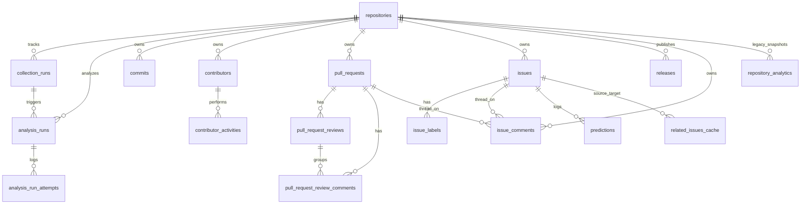

# OpenSourceLens — Database Architecture & Migrations

OpenSourceLens persists repository metadata, ingested GitHub entities, durable job queues, analytical snapshots, and Phase A ML audit logs in a relational schema defined with **SQLAlchemy 2.0** ([`backend/app/database/models.py`](../backend/app/database/models.py)) and managed across both **SQLite** (local/testing) and **PostgreSQL** (configured Docker target).

> **Scope & Cleanup Note:** See [product-vision.md](./product-vision.md) for target data expansion (GitHub Discussions tables, richer PR/issue/commit attributes, dynamic per-repo embeddings) and legacy Phase A persistence slated for later cleanup (`repository_analytics`, static `related_issues_cache`, [`ingest.py`](../backend/app/database/ingest.py), [`schema.sql`](../backend/app/database/schema.sql), [`schema_generator.py`](../backend/app/database/schema_generator.py)).

---

## 1. Engine & Session Configuration

Engine creation lives in [`backend/app/database/session.py`](../backend/app/database/session.py#L25-L98):

- **Connection URL Resolution (`get_database_url()`):** Reads `DATABASE_URL` (normalizing `postgres://` to `postgresql://`), falling back to local SQLite at `data/opensource_lens.db`.
- **SQLite Configuration (`build_engine()`):** Sets `check_same_thread=False` and attaches a `connect` event listener applying:
  - `PRAGMA journal_mode=WAL`
  - `PRAGMA synchronous=NORMAL`
  - `PRAGMA foreign_keys=ON`
  - `PRAGMA cache_size=-64000`
- **PostgreSQL Configuration:** Uses connection pooling (`pool_size=10`, `max_overflow=20`, `pool_pre_ping=True`).

---

## 2. Tables & Relationships (17 ORM Tables)

The live ORM registers **17 data tables** (plus Alembic's `alembic_version`):



### Core & Phase A Tables

| Table | Purpose | Key Constraints / Notes |
|---|---|---|
| `repositories` | Repository metadata, lifecycle flags (`is_active`, `is_archived`, `is_fork`, `upstream_repo`), sync timestamps (`last_synced_at`, `last_analyzed_at`), and `analytics_source_revision` (`Integer`, default `1`). | PK: `id` (GitHub ID or hash fallback on pending submit); Unique `ix_repositories_repo_name(repo_name)`. |
| `issues` | Pure GitHub issues (`39` cols: raw + cleaned text, evidence flags, canonical labels, resolution timing, censoring flags). | PK: `id`; FK: `repository_id -> repositories.id` (`CASCADE`); Unique index `ix_issues_repo_number(repo_name, issue_number)`. |
| `issue_labels` | Raw and mapped canonical labels per issue. | FK: `issue_id -> issues.id` (`CASCADE`). |
| `repository_analytics` | **Legacy Phase A** summary statistics snapshot consumed by legacy `/api/v1/repos/{owner}/{name}` and `/api/v1/analytics/*`. | FK: `repository_id -> repositories.id` (`CASCADE`). |
| `predictions` | Inference audit log for classification and resolution velocity calls. | FK: `issue_id -> issues.id` (`SET NULL`). |
| `related_issues_cache` | Precomputed top-K benchmark similarity edges. | FKs: `source_issue_id`, `target_issue_id -> issues.id` (`CASCADE`). |

### Phase B Ingestion & Multi-Entity Tables

| Table | Purpose | Key Constraints / Notes |
|---|---|---|
| `collection_runs` | Durable ingestion job queue and coverage/rate telemetry (`mode`, `status`, `worker_id`, `leased_until`, `lease_version`, `retry_count`, `max_retries=2`, `is_partial`, `coverage_summary`, `items_collected`, `rate_limit_consumed`). | Partial unique index `uq_collection_runs_active_repo` on `(repository_id) WHERE status IN ('pending', 'running')`. |
| `commits` | Commit metadata (`sha`, `author_name/email/login/id`, `author_date`, `committer_date`, `message`, optional `additions`, `deletions`, `total_changes`). | Unique constraint on `(repository_id, sha)`. |
| `contributors` | Repository contributors anchored on `github_id` or unlinked `git_email`, with `primary_role`, reconciled counts, `tenure_days`, `is_newcomer`, `is_core`, `is_bot`, `is_unlinked`, `identity_confidence`. | Two partial unique indexes: `uq_contributors_repo_github_id(repository_id, github_id) WHERE github_id IS NOT NULL` and `uq_contributors_repo_unlinked_email(repository_id, git_email) WHERE github_id IS NULL AND git_email IS NOT NULL`. |
| `contributor_activities` | Normalized per-event log (`commit`, `pr_opened`, `pr_reviewed`, `issue_opened`, `issue_comment`, etc.). | Unique `(repository_id, activity_type, entity_id)`. |
| `pull_requests` | Pull requests (`pr_number`, `state`, `created_at`, `closed_at`, `merged_at`, turnaround latencies, diff sizes `additions/deletions/changed_files`). | Indexed on `(repository_id, state, merged_at)`. Note: ORM lacks a unique constraint on `(repository_id, pr_number)` although Migration 002 created `uq_pr_repo_number`. |
| `pull_request_reviews` | Formal PR review envelopes (`review_id`, `state`, `submitted_at`, `author`, `author_id`). | Unique `ix_pull_request_reviews_review_id(review_id)`. |
| `pull_request_review_comments` | Inline diff review comments (`comment_id`, `path`, `line`, `commit_id`). | Unique `ix_pull_request_review_comments_comment_id(comment_id)`. |
| `releases` | Repository releases (`release_id`, `tag_name`, `name`, `published_at`, `is_prerelease`, `body`). | Unique `ix_releases_release_id(release_id)`. |
| `issue_comments` | Conversation comments attached to either an issue or a PR. | Unique `comment_id`; SQLite/Postgres `CHECK` constraint `NOT (issue_id IS NOT NULL AND pull_request_id IS NOT NULL)`. |

### Phase C Analytics Lifecycle Tables

| Table | Purpose | Key Constraints / Notes |
|---|---|---|
| `analysis_runs` | Durable Phase C analytics job queue, methodology/revision lineage (`requested_source_revision`, `analytics_source_revision`, `requested_methodology_version`, `methodology_version`, `analysis_reference_time`, `source_content_digest`), leasing (`worker_id`, `leased_until`, `lease_version`, `retry_count`, `max_retries=3`), and JSON outputs (`metrics_payload`, `coverage_summary`, `confidence_summary`, `rule_interpretations`). | FK: `repository_id` (`CASCADE`), `collection_run_id` (`SET NULL`). Partial unique index `uq_analysis_runs_active_repo` on `(repository_id) WHERE status IN ('pending', 'running')`. |
| `analysis_run_attempts` | Append-only attempt audit log (`attempt_number`, `worker_id`, `started_at`, `completed_at`, `outcome`, `error_category`, `error_message`, `interruption_reason`). | FK: `analysis_run_id` (`CASCADE`). CHECK constraint on `outcome`. Completed attempts reject later modification (`AttemptImmutableException`). |

---

## 3. Source Revisions, Runs, Deduplication & Fencing

### 3.1 Repository Source Revision Tracking
- `repositories.analytics_source_revision` begins at `1` and advances **atomically** (+1) at the end of [`RepositoryCollector.collect_repository()`](../backend/app/services/repository_collector.py#L132-L396) **only if** `mutated_records` is non-empty (meaning at least one insert or tracked field change occurred) or when historical rows exist under conditions requiring invalidation. Idempotent re-collections with zero data changes leave `analytics_source_revision` unchanged.
- An analysis is considered **stale** whenever `latest_completed_run.analytics_source_revision < repo.analytics_source_revision` (computed dynamically on V2 API reads in [`analytics.py`](../backend/app/api/v1/endpoints/analytics.py)).

### 3.2 Active Job Deduplication
- Both queues enforce **at most one active (`pending` or `running`) job per `repository_id`** via SQL partial unique indexes (`uq_collection_runs_active_repo` and `uq_analysis_runs_active_repo`) plus pre-insert integrity checks.
- **No-op suppression:** `AnalyticsJobQueue.enqueue_analysis()` inspects whether a completed `AnalysisRun` already exists matching both the repository's current `analytics_source_revision` and the requested `methodology_version`. If `force=False` and a match exists, it returns the existing completed run instead of creating duplicate work.

### 3.3 Lease & Fencing Mechanisms
- **Claiming:** On PostgreSQL, `claim_job()` / `claim_next_job()` issues `SELECT ... FOR UPDATE SKIP LOCKED`. On SQLite, it executes inside `BEGIN IMMEDIATE` or dialect-safe locking (single-writer semantics).
- **Optimistic Lease-Version Fencing:** Every claim increments `lease_version += 1`, sets `worker_id`, and sets `leased_until = now + lease_duration_seconds` (`600s` default in both workers).
- Every heartbeat renewal, publication, failure recording, or stale abortion verifies `(id, worker_id, lease_version, status == 'running')` via a conditional `UPDATE ... WHERE ...` rowcount check. If `rowcount == 0`, a ghost worker is rejected (`JobLeaseLostException` / `GhostWorkerRejectedException`).
- **Mid-Run Source Revision Protection:** During `AnalyticsOrchestrator.process_claimed_run()`, after computation finishes and right before `publish_and_finalize()`, if the repository's `analytics_source_revision` advanced beyond the run's pinned snapshot revision (and a newer completed run already superseded it), `_abort_superseded_stale_run()` aborts the older snapshot run with `status="cancelled"` (and attempt `outcome="interrupted"`) and allows replacement work rather than overwriting newer repository truth.

---

## 4. Alembic Migrations & Known Schema Drift Warning

Migrations reside in [`backend/alembic/versions/`](../backend/alembic/versions/) and run in this order:

1. `001_initial_benchmark_schema` (`<base> -> 001_initial_benchmark_schema`)
2. `002_add_dynamic_tables` (`001_initial_benchmark_schema -> 002_add_dynamic_tables`)
3. `003_add_phase_c_analytics_infrastructure` (`002_add_dynamic_tables -> 003_add_phase_c_analytics_infrastructure`)

[`backend/alembic/env.py`](../backend/alembic/env.py) configures `render_as_batch=True` for SQLite compatibility and supports overriding the target database with `-x db_url=...` or `-x db_path=...`, otherwise falling back to `DATABASE_URL` or `get_database_url()`.

> [!WARNING]
> **Critical Migration 001 vs. Phase A ORM Drift:** Inspection of [`001_initial_benchmark_schema.py`](../backend/alembic/versions/001_initial_benchmark_schema.py) against [`backend/app/database/models.py`](../backend/app/database/models.py) reveals column mismatches on three Phase A tables (`issue_labels` `raw_label/normalized_label` vs. ORM `label_name/is_canonical/canonical_category`; `repository_analytics` flat columns vs. ORM `category_distribution`/`speed_tier_distribution` JSON columns; `predictions` `model_version` vs. ORM `input_title`/`input_body`). The checked-in SQLite file `data/opensource_lens.db` matches the ORM (having been initialized via `init_db()` / `create_all` before migrations 002/003), whereas running `alembic upgrade head` alone on a completely empty database produces mismatched Phase A tables. See [OPENSOURCELENS_BACKEND_AUDIT.md §5 & §21](./audits/OPENSOURCELENS_BACKEND_AUDIT.md).

---

## 5. SQLite vs. PostgreSQL Behavior

| Capability | SQLite (`WAL`) — Local Default | PostgreSQL — Target Production Engine |
|---|---|---|
| **Driver / Dependencies** | Built into Python stdlib (`sqlite3`). | Requires installing commented-out `psycopg2-binary` from [`backend/requirements.txt`](../backend/requirements.txt). |
| **Queue Locking** | File-level writer serialization (`BEGIN IMMEDIATE` / single-writer); multi-worker claim contention returns lock/busy errors if heavily concurrent. | Row-level `FOR UPDATE SKIP LOCKED` in `DurableJobQueue.claim_next_job` and `AnalyticsJobQueue.claim_job`. |
| **Snapshot Reads** | Tested in WAL mode (`tests/test_analytics_queue.py`) using a dedicated read connection/session. | Tested only via SQL compilation/unit mocks; **live multi-worker PostgreSQL execution is currently unverified**. |
| **BigInteger PKs** | Mapped with `.with_variant(Integer, "sqlite")` in migrations (`PK_TYPE`) for autoincrement compatibility. | Native 64-bit `BIGINT` identity sequences. |

### Migration Verification Commands
Note: On Windows environments where `alembic.exe` may be restricted or when invoking inside the repository virtualenv, run Alembic as a Python module:

```powershell
.\.venv\Scripts\python.exe -m alembic -c alembic.ini current
.\.venv\Scripts\python.exe -m alembic -c alembic.ini history
```
