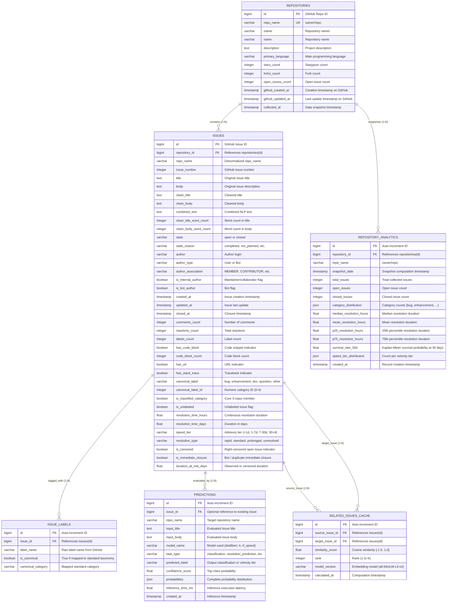

# OpenSourceLens — Database Schema Specification

## 1. Executive Summary & Design Principles

The OpenSourceLens relational database schema serves as the primary persistence and retrieval layer connecting offline data science workflows (Phases 1–8) with the online FastAPI backend (Phase 9) and Next.js frontend (Phase 10).

### Core Design Principles
1. **Separation of Online Serving vs. Offline Model Training:**
   - Raw model checkpoint weights and raw multi-gigabyte training files remain git-ignored on filesystem storage.
   - The database stores structured repository metadata, cleaned issue attributes, precomputed analytics, audit logs of inference predictions, and precomputed semantic similarity scores.
2. **Dual-Driver Dialect Compatibility (PostgreSQL + SQLite):**
   - **PostgreSQL (Production):** The production target utilizes `BIGSERIAL`, `TIMESTAMP WITH TIME ZONE`, and native `JSON`/`JSONB` columns with connection pooling (`pool_size=10, max_overflow=20`).
   - **SQLite (Development / Testing / Offline):** The zero-configuration SQLite fallback allows instant unit testing and offline local running without external server dependencies. SQLAlchemy 2.0 generic types (`BigInteger`, `DateTime(timezone=True)`, `JSON`) automatically adapt to both dialects.
3. **Optimized for High-Throughput REST API Inquiries:**
   - Composite B-tree indexes are specifically tailored to FastAPI access patterns: `(repo_name, issue_number)`, `(repo_name, state)`, `(repo_name, canonical_label)`, and `(source_issue_id, rank)`.
4. **Relational Integrity with Cascading Life-Cycles:**
   - Deleting a repository cascades cleanly to its child issues and analytics.
   - Deleting an issue cascades to its labels and related-issue links, while prediction audit logs are preserved (`ON DELETE SET NULL`) for compliance and evaluation tracking.

---

## 2. Entity-Relationship Diagram (ERD)

---

## 3. Data Dictionary

### 3.1 Table: `repositories`
Stores high-level metadata for open-source repositories analyzed by OpenSourceLens.

| Column | Type | Nullable | Default | Description |
|---|---|---|---|---|
| `id` | BIGINT | No | — | GitHub repository identifier (Primary Key) |
| `repo_name` | VARCHAR(120) | No | — | Full repo name `owner/repo` (Unique, Indexed) |
| `owner` | VARCHAR(80) | No | — | GitHub organization or user handle |
| `name` | VARCHAR(80) | No | — | Repository name |
| `description` | TEXT | Yes | NULL | Repository summary description |
| `primary_language` | VARCHAR(60) | Yes | NULL | Primary programming language |
| `stars_count` | INTEGER | No | 0 | Total GitHub stargazers |
| `forks_count` | INTEGER | No | 0 | Total GitHub forks |
| `open_issues_count` | INTEGER | No | 0 | Total open issues reported by GitHub |
| `github_created_at` | TIMESTAMPTZ | Yes | NULL | Repository inception timestamp |
| `github_updated_at` | TIMESTAMPTZ | Yes | NULL | Last repository update timestamp |
| `collected_at` | TIMESTAMPTZ | No | `now()` | Ingestion snapshot timestamp |

### 3.2 Table: `issues`
Stores cleaned issues, text features, engineered NLP metadata, and Phase 8 resolution metrics.

| Column | Type | Nullable | Default | Description |
|---|---|---|---|---|
| `id` | BIGINT | No | — | GitHub issue ID (Primary Key) |
| `repository_id` | BIGINT | No | — | Foreign Key -> `repositories.id` (ON DELETE CASCADE) |
| `repo_name` | VARCHAR(120) | No | — | Indexed repository identifier |
| `issue_number` | INTEGER | No | — | Issue number within repository |
| `title` | TEXT | No | — | Raw issue title |
| `body` | TEXT | Yes | NULL | Raw issue body |
| `clean_title` | TEXT | Yes | NULL | Cleaned title text |
| `clean_body` | TEXT | Yes | NULL | Cleaned body text |
| `combined_text` | TEXT | Yes | NULL | Cleaned title + body for NLP vectorization |
| `clean_title_word_count` | INTEGER | No | 0 | Clean title word count |
| `clean_body_word_count` | INTEGER | No | 0 | Clean body word count |
| `state` | VARCHAR(30) | No | — | Current state (`open` or `closed`) |
| `state_reason` | VARCHAR(50) | Yes | NULL | Reason for state (`completed`, `not_planned`) |
| `author` | VARCHAR(100) | No | — | Author login name |
| `author_type` | VARCHAR(40) | No | `'User'` | Author entity type (`User`, `Bot`) |
| `author_association` | VARCHAR(40) | No | `'NONE'` | Relationship (`MEMBER`, `CONTRIBUTOR`, `NONE`) |
| `is_internal_author` | BOOLEAN | No | `FALSE` | True if author is repo member or collaborator |
| `is_bot_author` | BOOLEAN | No | `FALSE` | True if author is an automated bot |
| `created_at` | TIMESTAMPTZ | No | — | Issue submission timestamp |
| `updated_at` | TIMESTAMPTZ | Yes | NULL | Last modification timestamp |
| `closed_at` | TIMESTAMPTZ | Yes | NULL | Issue resolution timestamp (NULL if open) |
| `comments_count` | INTEGER | No | 0 | Total comments count |
| `reactions_count` | INTEGER | No | 0 | Total emoji reactions count |
| `labels_count` | INTEGER | No | 0 | Number of raw labels attached |
| `has_code_block` | BOOLEAN | No | `FALSE` | Contains markdown code block |
| `code_block_count` | INTEGER | No | 0 | Total code blocks detected |
| `has_url` | BOOLEAN | No | `FALSE` | Contains HTTP/HTTPS link |
| `has_stack_trace` | BOOLEAN | No | `FALSE` | Contains programming stack trace |
| `canonical_label` | VARCHAR(50) | No | `'other'` | Normalized category (`bug`, `enhancement`, etc.) |
| `canonical_label_id` | INTEGER | No | -1 | Integer category ID (0=bug, 1=enhancement, etc.) |
| `is_classified_category` | BOOLEAN | No | `FALSE` | True if part of primary evaluation categories |
| `is_unlabeled` | BOOLEAN | No | `FALSE` | True if issue had no labels |
| `resolution_time_hours` | FLOAT | Yes | NULL | Hours from `created_at` to `closed_at` |
| `resolution_time_days` | FLOAT | Yes | NULL | Days from `created_at` to `closed_at` |
| `speed_tier` | VARCHAR(30) | Yes | NULL | Velocity tier (`< 1 Day`, `1-7 Days`, etc.) |
| `resolution_type` | VARCHAR(30) | Yes | NULL | Resolution velocity category |
| `is_censored` | BOOLEAN | No | `FALSE` | True for open issues (survival analysis) |
| `is_immediate_closure` | BOOLEAN | No | `FALSE` | Closed in < 15 min (bot/duplicate) |
| `duration_at_risk_days` | FLOAT | Yes | NULL | Censored or observed survival time |

### 3.3 Table: `issue_labels`
Normalized relational mapping for GitHub labels.

| Column | Type | Nullable | Default | Description |
|---|---|---|---|---|
| `id` | BIGINT | No | Autoincrement | Primary Key |
| `issue_id` | BIGINT | No | — | Foreign Key -> `issues.id` (ON DELETE CASCADE) |
| `label_name` | VARCHAR(100) | No | — | Raw label text from repository |
| `is_canonical` | BOOLEAN | No | `FALSE` | True if maps to standard taxonomy |
| `canonical_category` | VARCHAR(50) | Yes | NULL | Standardized category name |

### 3.4 Table: `repository_analytics`
Precomputed historical snapshots for repository-level dashboards and SLA analytics.

| Column | Type | Nullable | Default | Description |
|---|---|---|---|---|
| `id` | BIGINT | No | Autoincrement | Primary Key |
| `repository_id` | BIGINT | No | — | Foreign Key -> `repositories.id` (ON DELETE CASCADE) |
| `repo_name` | VARCHAR(120) | No | — | Indexed repository identifier |
| `snapshot_date` | TIMESTAMPTZ | No | `now()` | Timestamp of metric computation |
| `total_issues` | INTEGER | No | 0 | Total issues analyzed |
| `open_issues` | INTEGER | No | 0 | Total open issues |
| `closed_issues` | INTEGER | No | 0 | Total resolved issues |
| `category_distribution` | JSON | Yes | NULL | Count per canonical label `{bug: 420, ...}` |
| `median_resolution_hours` | FLOAT | Yes | NULL | Median resolution time (hours) |
| `mean_resolution_hours` | FLOAT | Yes | NULL | Mean resolution time (hours) |
| `p25_resolution_hours` | FLOAT | Yes | NULL | 25th percentile resolution time |
| `p75_resolution_hours` | FLOAT | Yes | NULL | 75th percentile resolution time |
| `survival_rate_30d` | FLOAT | Yes | NULL | 30-day Kaplan-Meier survival probability |
| `speed_tier_distribution` | JSON | Yes | NULL | Distribution of issues across speed tiers |
| `created_at` | TIMESTAMPTZ | No | `now()` | Creation timestamp |

### 3.5 Table: `predictions`
Audit trail of real-time machine learning predictions generated by FastAPI endpoints.

| Column | Type | Nullable | Default | Description |
|---|---|---|---|---|
| `id` | BIGINT | No | Autoincrement | Primary Key |
| `issue_id` | BIGINT | Yes | NULL | Optional Foreign Key -> `issues.id` (ON DELETE SET NULL) |
| `repo_name` | VARCHAR(120) | Yes | NULL | Target repository name |
| `input_title` | TEXT | No | — | Evaluated issue title |
| `input_body` | TEXT | Yes | NULL | Evaluated issue body text |
| `model_name` | VARCHAR(80) | No | — | Model identifier (e.g. `distilbert`, `tfidf_svm`, `rf_speed`) |
| `task_type` | VARCHAR(50) | No | — | `classification`, `related_issues`, or `resolution_prediction` |
| `predicted_label` | VARCHAR(80) | Yes | NULL | Predicted class name or speed tier |
| `confidence_score` | FLOAT | Yes | NULL | Softmax or model confidence score |
| `probabilities` | JSON | Yes | NULL | Full class probability dictionary |
| `inference_time_ms` | FLOAT | No | 0.0 | Processing latency in milliseconds |
| `created_at` | TIMESTAMPTZ | No | `now()` | Prediction timestamp |

### 3.6 Table: `related_issues_cache`
Precomputed semantic similarity pairings and top-K nearest neighbors.

| Column | Type | Nullable | Default | Description |
|---|---|---|---|---|
| `id` | BIGINT | No | Autoincrement | Primary Key |
| `source_issue_id` | BIGINT | No | — | Foreign Key -> `issues.id` (ON DELETE CASCADE) |
| `target_issue_id` | BIGINT | No | — | Foreign Key -> `issues.id` (ON DELETE CASCADE) |
| `similarity_score` | FLOAT | No | — | Cosine similarity $[-1.0, 1.0]$ |
| `rank` | INTEGER | No | — | Similarity ranking (1 to $K$) |
| `model_version` | VARCHAR(60) | No | `'all-MiniLM-L6-v2'` | Embedding model identifier |
| `calculated_at` | TIMESTAMPTZ | No | `now()` | Computation timestamp |

---

## 4. Indexing Strategy & Query Optimization

| Index Name | Table | Columns | Unique | Query Acceleration Purpose |
|---|---|---|---|---|
| `ix_repositories_repo_name` | `repositories` | `(repo_name)` | Yes | Instant repo lookup via route `/api/repos/{owner}/{name}` |
| `ix_issues_repo_number` | `issues` | `(repo_name, issue_number)` | Yes | Single-issue detail fetch `/api/repos/{owner}/{name}/issues/{number}` |
| `ix_issues_repo_state` | `issues` | `(repo_name, state)` | No | Filter open vs closed issues for dashboard overview |
| `ix_issues_repo_canonical` | `issues` | `(repo_name, canonical_label)` | No | Category breakdown charts and filtered issue lists |
| `ix_issues_repo_speed_tier` | `issues` | `(repo_name, speed_tier)` | No | Resolution velocity analytics queries |
| `ix_issues_created_at` | `issues` | `(created_at)` | No | Chronological ordering, pagination, and time-series trends |
| `ix_issues_closed_at` | `issues` | `(closed_at)` | No | Closed-issue resolution filtering |
| `ix_analytics_repo_date` | `repository_analytics` | `(repository_id, snapshot_date)` | No | Time-series retrieval of repository health snapshots |
| `ix_related_source_rank` | `related_issues_cache` | `(source_issue_id, rank)` | No | Sub-5ms retrieval of top-K related issues for issue $X$ |
| `uq_related_source_target` | `related_issues_cache` | `(source_issue_id, target_issue_id)` | Yes | Enforces unique relationship edges between issue pairs |

---

## 5. Ingestion Mapping (Phase 1–8 Assets to Relational Tables)

When ingesting existing processed assets in Step 9.3:
1. `data/raw/repositories/*.json` -> `repositories` table.
2. `data/processed/issues_resolution.parquet` -> `issues` table (all 2,328 issues, joining resolution fields).
3. `issues['raw_labels']` list -> `issue_labels` table.
4. Descriptive statistics from Phase 3 & Phase 8 manifests -> `repository_analytics` table.
5. `models/transformer/issue_embeddings.pt` cosine similarity matrix -> `related_issues_cache` table.
