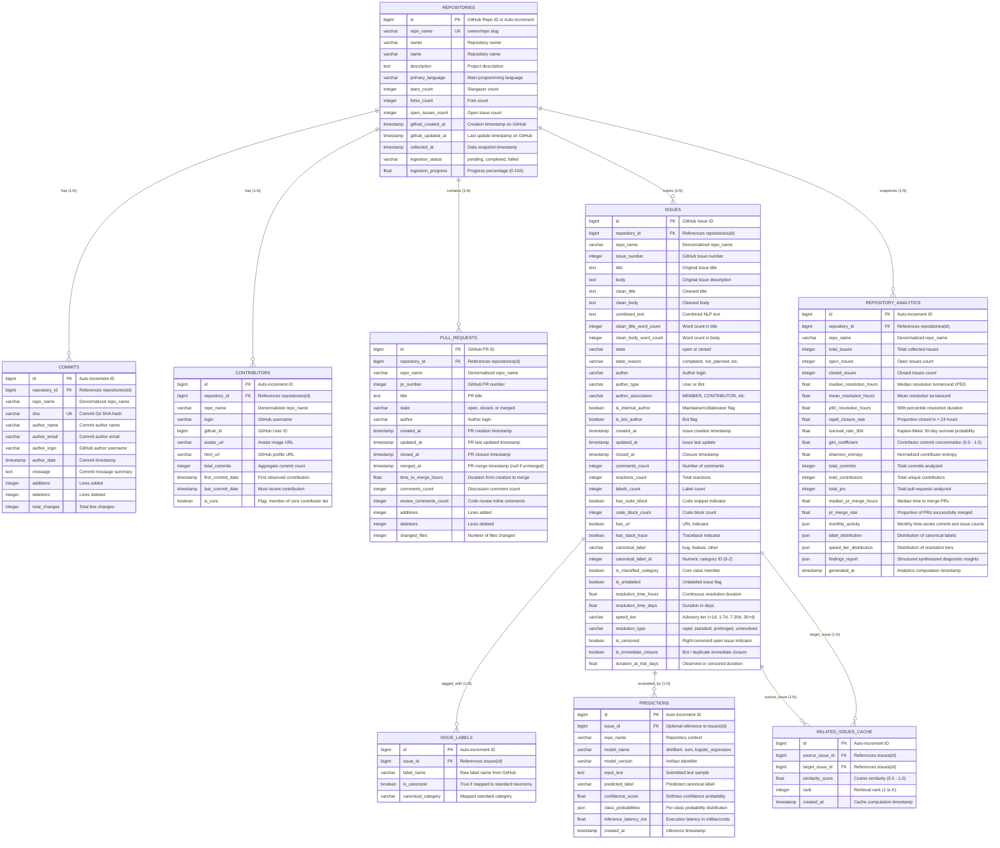

# OpenSourceLens — Database Schema Specification

> [!NOTE]
> **Historical Planning Document (Pre-Phase B/C):** This early design spec omits implemented Phase B/C tables (`collection_runs`, `analysis_runs`, `analysis_run_attempts`, `pull_request_reviews`, `pull_request_review_comments`, `releases`, `issue_comments`, `contributor_activities`) and lists draft columns (`ingestion_status`, `repo_name` on commits/PRs, etc.) that were not added. For the actual 17-table SQLAlchemy schema and Alembic migrations, see [docs/database.md](./database.md).

## 1. Executive Summary & Design Principles

The OpenSourceLens relational database schema serves as the primary persistence and retrieval layer connecting offline data science workflows (Track A) and online dynamic repository intelligence (Track B) with the high-performance FastAPI backend and Next.js frontend.

### Core Design Principles
1. **Universal Multi-Entity Architecture:**
   - The schema models all critical open-source software engineering entities: **Repositories**, **Commits**, **Contributors**, **Pull Requests**, **Issues**, **Issue Labels**, and **Derived Analytics**.
   - Tables are fully generic and relational; no tables or views are partitioned or hardcoded to specific repository names.
2. **Dual-Driver Dialect Compatibility (PostgreSQL + SQLite):**
   - **PostgreSQL (Production):** The production target utilizes `BIGSERIAL`, `TIMESTAMP WITH TIME ZONE`, and native `JSON`/`JSONB` columns with connection pooling (`pool_size=10, max_overflow=20`).
   - **SQLite (Development / Testing / Offline):** The zero-configuration SQLite fallback allows instant unit testing and offline local execution without external server dependencies. SQLAlchemy 2.0 generic types (`BigInteger`, `DateTime(timezone=True)`, `JSON`) adapt transparently to both dialects.
3. **Optimized for High-Throughput REST API Access:**
   - Composite B-tree indexes are tailored to access patterns: `(repo_name, issue_number)`, `(repo_name, state)`, `(repo_name, canonical_label)`, `(repository_id, author_date)`, `(repository_id, merged_at)`, and `(source_issue_id, rank)`.
4. **Relational Integrity with Cascading Life-Cycles:**
   - Deleting or re-ingesting a repository cascades cleanly to child commits, contributors, pull requests, issues, and analytics.
   - Prediction audit logs are preserved (`ON DELETE SET NULL`) for model evaluation and latency tracking.

---

## 2. Entity-Relationship Diagram (ERD)

---

## 3. Entity Definitions & Attribute Specifications

### 3.1 `repositories` Table
Stores high-level metadata and ingestion status for every analyzed repository.
- `id` (BigInteger, PK): GitHub numeric repository ID or internal sequential identifier.
- `repo_name` (String(255), Unique, Indexed): Canonical `{owner}/{name}` identifier.
- `ingestion_status` (String(32)): Workflow state (`pending`, `ingesting`, `completed`, `failed`).
- `ingestion_progress` (Float): Ingestion completion percentage (0.0 to 100.0).

### 3.2 `commits` Table
Stores commit activity records for development velocity, burstiness, and time-series trend analysis.
- `sha` (String(40), Unique, Indexed): 40-character Git commit hash.
- `repository_id` (BigInteger, FK): Foreign key referencing `repositories.id` (`ON DELETE CASCADE`).
- `author_date` (DateTime): Commit authoring timestamp for temporal bucketing.
- `additions` / `deletions` / `total_changes` (Integer): Lines added, deleted, and modified.

### 3.3 `contributors` Table
Maintains contributor profiles and aggregate contribution statistics for ecosystem modeling.
- `repository_id` (BigInteger, FK): Foreign key referencing `repositories.id` (`ON DELETE CASCADE`).
- `login` (String(255), Indexed): GitHub username.
- `total_commits` (Integer): Aggregate number of commits by this contributor.
- `first_commit_date` / `last_commit_date` (DateTime): Boundary timestamps for tenure and retention calculation.
- `is_core` (Boolean): Flag indicating membership in the core contributor tier (top 10% volume).

### 3.4 `pull_requests` Table
Records pull request lifecycles to model code-review turnaround, velocity, and backlog growth.
- `pr_number` (Integer, Indexed): GitHub repository-scoped pull request number.
- `state` (String(32)): `open`, `closed`, or `merged`.
- `merged_at` (DateTime, Nullable): Timestamp of merge closure (null if unmerged or rejected).
- `time_to_merge_hours` (Float, Nullable): Elapsed hours from `created_at` to `merged_at`.
- `comments_count` / `review_comments_count` (Integer): Quantity of discussion and inline code review.

### 3.5 `issues` Table
The central corpus table containing cleaned text, extracted engineering features, classification targets, and resolution metrics.
- `issue_number` (Integer, Indexed): GitHub repository-scoped issue number.
- `combined_text` (Text): Cleaned title concatenated with cleaned body for NLP models.
- `canonical_label` (String(32), Indexed): Normalized class (`bug`, `feature`, `other`).
- `resolution_time_hours` (Float, Nullable): Elapsed duration from `created_at` to `closed_at`.
- `speed_tier` (String(32)): Resolution velocity bracket (`< 1 Day`, `1-7 Days`, `7-30 Days`, `30+ Days`).

### 3.6 `repository_analytics` Table
Persists precalculated statistical snapshots, time-series aggregations, and synthesized findings for instant dashboard rendering.
- `monthly_activity` (JSON): Temporal array of `{month, commits, issues_created, issues_closed, prs_merged}`.
- `gini_coefficient` (Float): Contributor commit concentration metric (0.0 to 1.0).
- `findings_report` (JSON): Array of structured diagnostic observations with evidence tags.

---

## 4. Indexing Strategy & Performance Optimization

To guarantee sub-100ms API response times across tables containing tens of thousands of rows:
1. **Repository-Scoped Lookups:**
   - `idx_issues_repo_number`: `(repo_name, issue_number)` UNIQUE.
   - `idx_commits_repo_date`: `(repository_id, author_date)`.
   - `idx_prs_repo_merged`: `(repository_id, merged_at)`.
2. **Faceted Filtering Indexes:**
   - `idx_issues_repo_state_label`: `(repo_name, state, canonical_label)`.
   - `idx_issues_speed_tier`: `(repo_name, speed_tier)`.
3. **Similarity Search Ranking:**
   - `idx_related_source_rank`: `(source_issue_id, rank)`.
